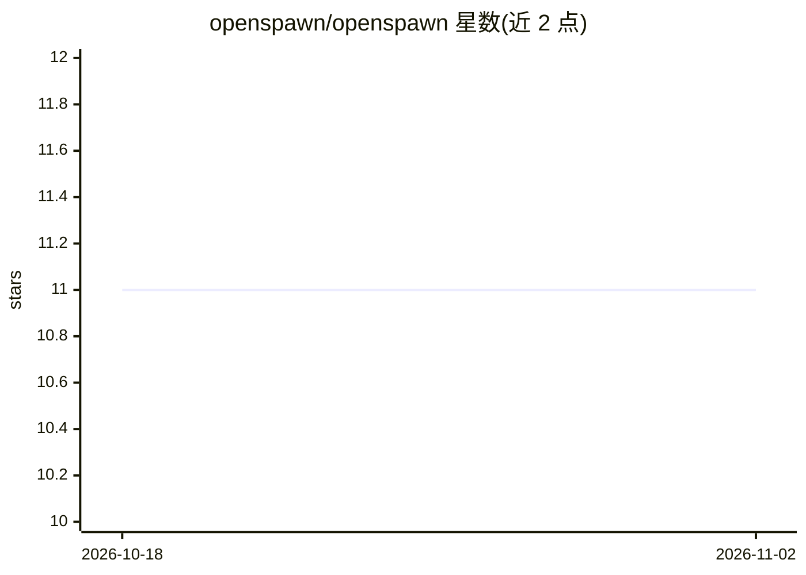

# openspawn/openspawn

⭐ 11 · TypeScript · MIT · 推送 2026-10-19 · [GitHub](https://github.com/openspawn/openspawn) · [官网](https://openspawn.ai) · 组织维护

**多智能体协调平台：用 markdown 定义组织并协调 agent 运行**

开源多智能体协调平台，定位为控制平面而非框架：以 ORG.md（markdown）定义 agent 组织，通过 A2A 协议发现与管理任务、MCP Server（Streamable HTTP 提供 7 个工具）、模型路由（Ollama/Groq/OpenRouter）协调既有 agent 技术栈（CrewAI/LangGraph/AutoGen/OpenClaw 等）。可将 Claude Code CLI agent 作为协调子进程启动，提供实时仪表盘（网络图、任务时间线、积分）与 SSE 事件流。本地模式基于 SQLite，无需 Docker/Postgres；要求 Node.js 18+、Python 3.12+、uv。

## 筛选速览

| 维度 | 判定 | 备注 |
|---|---|---|
| AI 角色 | `ai-ecosystem` | LLM/agent 周边工具 |
| 许可风险 | `permissive` | MIT |
| 部署形态 | `library` | 以包/库形式分发 |
| 模型依赖 | local-ok | 支持本地模型 |
| 硬件要求 | — | 无带数字的原话,不猜 |
| 安装摩擦 | `low` | 无编译、无系统依赖或容器化 |
| 成熟度 | — | 结构信号不足 |

## 能力要点

- ORG.md 用 markdown 定义 agent 组织
- A2A 协议发现 + MCP Server（7 个工具，Streamable HTTP）
- 模型路由支持 Ollama/Groq/OpenRouter
- SQLite 本地模式与实时仪表盘，preview 模式无需 API key

## 适用场景

- 把现有的 CrewAI/LangGraph/AutoGen agent 组织起来协同工作
- 用 markdown 声明式定义多 agent 组织结构并实时观察运行
- 在本地无 Docker 环境下搭建多 agent 协调控制平面

## 场景标签

`多智能体` `Agent 框架` · 领域:Agent 开发

## 证据(README 行号)

> L12: OpenSpawn is an open-source multi-agent coordination platform — the control plane for AI agent organizations. Defin
> L14: **Infrastructure, not a framework.** OpenSpawn doesn't replace your agent stack — it coordinates it. Works with Cre

## 星数曲线

2026-10-18 11 → 2026-11-02 11（+0）

---
*卡片 v1 · prompt 1.4 · 生成 2026-11-01 · 置信度 high · 依据 README sha `c57d7e184257` · [字段定义](../../DATASET.md)*
