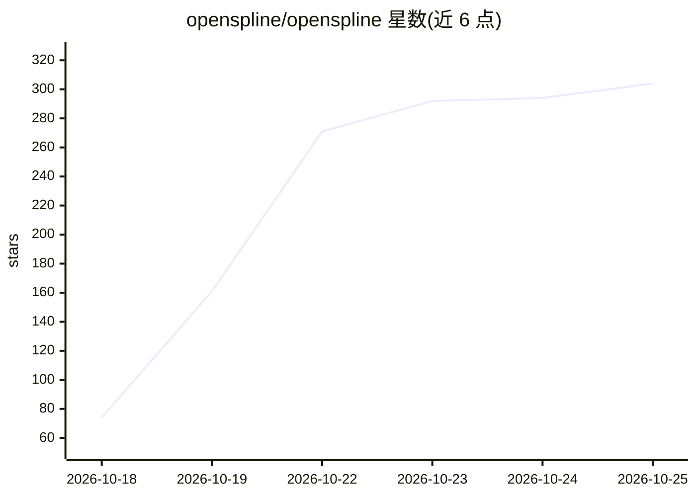

# openspline/openspline

⭐ 304 · Python · MIT · 推送 2026-10-21 · [GitHub](https://github.com/openspline/openspline) · [官网](https://www.openspline.dev/) · 组织维护

**给语音 AI 代理生成实时口型同步数字人视频的工具**

将静态肖像与生成的音频流合成为口型同步的数字人视频，供已有语音 AI 代理接入展示。提供 Python 与 Node SDK、内置 Viewer/React/Web 组件，通过连接器对接 OpenAI Realtime、LiveKit、Gemini Realtime、ElevenLabs Agents 等既有代理框架。可使用 Openspline Cloud 托管，或在自有 NVIDIA GPU 上自托管（Linux/WSL2 安装脚本，多 GPU worker 配置）。限制：AMD 与 Apple GPU 暂不支持，长时运行与多云厂商验证未完成。

## 筛选速览

| 维度 | 判定 | 备注 |
|---|---|---|
| AI 角色 | `ai-native` | 本体是模型或模型工具 |
| 许可风险 | `permissive` | MIT |
| 部署形态 | `library` | 以包/库形式分发 |
| 模型依赖 | — | README 未给出锁定关系 |
| 硬件要求 | — | 无带数字的原话,不猜 |
| 安装摩擦 | `medium` | 含编译或系统依赖之一 |
| 成熟度 | `idea` | |

## 能力要点

- 肖像+音频流生成口型同步视频，5 行代码接入
- OpenAI Realtime / LiveKit / Gemini Realtime / ElevenLabs 现成连接器
- Cloud 托管或自有 NVIDIA GPU 自托管，支持多 GPU worker
- 内置 Viewer、React 组件与 Web 组件用于展示

## 适用场景

- 为我的语音 AI 客服/代理加上会说话的数字人脸
- 在自有 GPU 上本地运行数字人视频生成
- 在 LiveKit 等实时通话场景中嵌入数字人形象

## 场景标签

`视频生成` · 领域:内容生成

## 证据(README 行号)

> L8: **Add a live face to any voice AI agent in five lines.** Turn a portrait and generated audio into synchronized video
> L104: Install `pip install openai==2.54.0`. Wrap your existing OpenAI Realtime connection; tools and transcripts still r

## 星数曲线

2026-10-18 74 → 2026-10-25 304（+230）

---
*卡片 v1 · prompt 1.4 · 生成 2026-10-22 · 置信度 high · 依据 README sha `b6e6939d53ba` · [字段定义](../../DATASET.md)*
