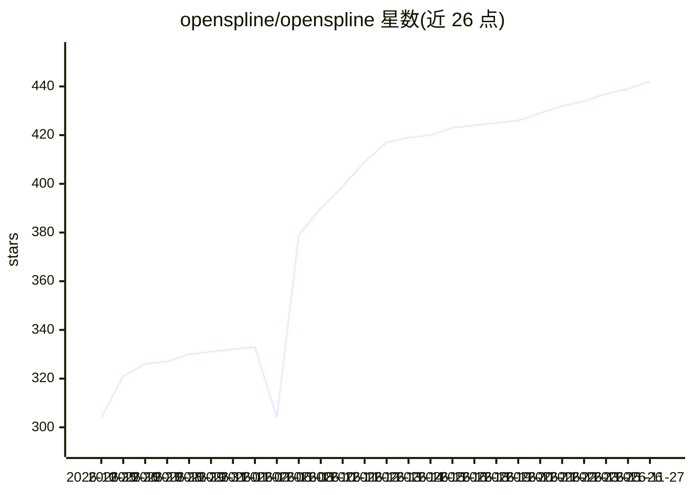

# openspline/openspline

⭐ 442 · Python · MIT · 推送 2026-11-14 · [GitHub](https://github.com/openspline/openspline) · [官网](https://www.openspline.dev/) · 组织维护

**给语音 AI agent 加实时数字人视频的开发库**

OpenSpline 将一张人像与生成的音频合成为口型同步的实时视频，供语音 AI agent 使用。以 Python SDK、Node SDK 与自托管 GPU 服务形式提供，也提供 Cloud 托管；通过连接器接入 OpenAI Realtime、Gemini Live、ElevenLabs Agents、LiveKit 等现有 agent 会话，保留原有的提示词、工具与转写处理。自托管需 NVIDIA GPU（不支持 AMD/Apple GPU），Linux/WSL2 通过安装脚本部署，内置 viewer 与 React/Web 组件用于展示。

## 筛选速览

| 维度 | 判定 | 备注 |
|---|---|---|
| AI 角色 | `ai-native` | 本体是模型或模型工具 |
| 许可风险 | `permissive` | MIT |
| 部署形态 | `library` | 以包/库形式分发 |
| 模型依赖 | — | README 未给出锁定关系 |
| 硬件要求 | — | 无带数字的原话,不猜 |
| 安装摩擦 | `medium` | 含编译或系统依赖之一 |
| 成熟度 | — | 结构信号不足 |

## 能力要点

- 5 行代码将人像+音频转为口型同步的实时视频
- 提供 OpenAI Realtime、Gemini Live、ElevenLabs、LiveKit、Pipecat 等连接器
- Cloud 托管与自托管 GPU 两种运行方式，支持多 GPU worker 配置
- Python 与 Node 双 SDK，内置 viewer、React 与 web 组件

## 适用场景

- 给现有语音 agent 加上可视化数字人形象
- 本地 GPU 上自托管实时 avatar 生成服务
- 在 LiveKit 会话中向前端推送同步音视频

## 场景标签

`语音 Agent` · 领域:对话与助手

## 证据(README 行号)

> L8: **Add a live face to any voice AI agent in five lines.** Turn a portrait and generated audio into synchronized video
> L100: These snippets plug into an existing async agent. Openspline owns output playback; disable your previous speaker o

## 星数曲线

2026-10-25 304 → 2026-11-27 442（+138）

---
*卡片 v1 · prompt 1.4 · 生成 2026-11-25 · 置信度 high · 依据 README sha `0c4d4e838456` · [字段定义](../../DATASET.md)*
