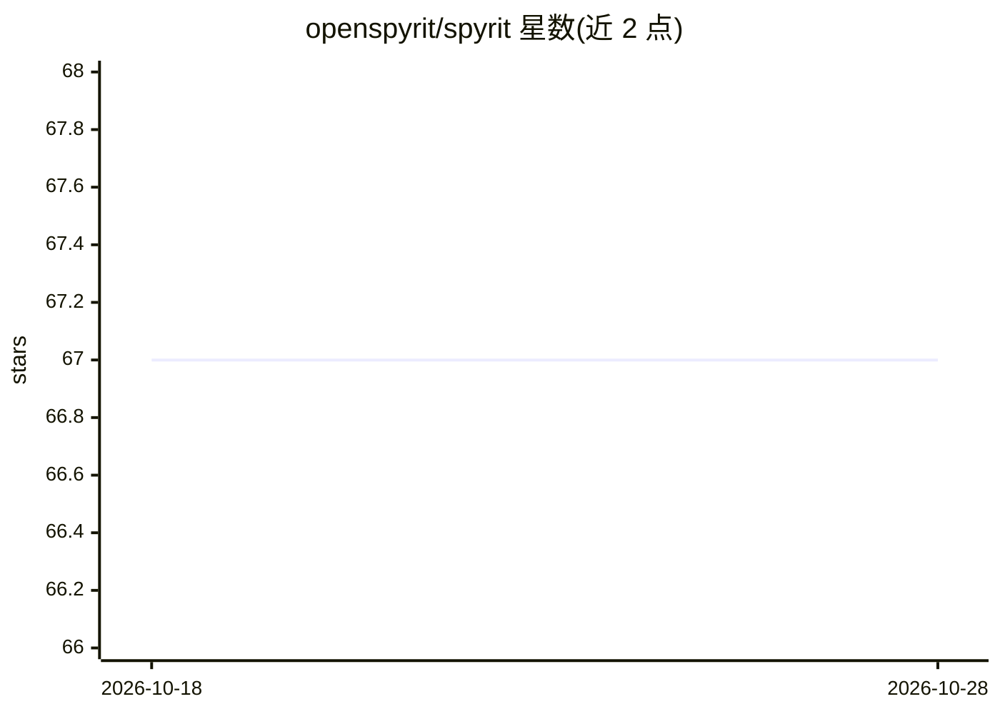

# openspyrit/spyrit

⭐ 67 · Python · LGPL-3.0 · 推送 2026-10-20 · [GitHub](https://github.com/openspyrit/spyrit) · [官网](https://spyrit.readthedocs.io/en/) · 组织维护

**单像素成像的 PyTorch 深度图像重建工具箱**

基于 PyTorch 的深度图像重建 Python 包，主要面向单像素成像（single-pixel imaging），主题涉及医学成像。提供 pip 安装（Linux/macOS/Windows 均支持），Windows 下可能需先安装 PyTorch（CPU 版用 pip、GPU 版用 conda 安装 pytorch-cuda=12.4）；开发者模式支持 git clone 后 pip install -e . 安装。附带教程目录与文档（spyrit.readthedocs.io），进阶示例在 spyrit-examples 仓库并可在 Colab 运行。采用 LGPL-3.0 许可，发表成果需引用团队论文。

## 筛选速览

| 维度 | 判定 | 备注 |
|---|---|---|
| AI 角色 | `ai-native` | 本体是模型或模型工具 |
| 许可风险 | `viral` | LGPL-3.0 |
| 部署形态 | `library` | 以包/库形式分发 |
| 模型依赖 | — | README 未给出锁定关系 |
| 硬件要求 | — | 无带数字的原话,不猜 |
| 安装摩擦 | `medium` | 含编译或系统依赖之一 |
| 成熟度 | — | 结构信号不足 |

## 能力要点

- 基于 PyTorch 的单像素成像深度重建算法包
- 支持 Linux/macOS/Windows 三平台安装
- 提供教程与 API 文档，进阶示例可在 Colab 运行
- LGPL-3.0 许可，附引用论文（Optics Express 2021/2023）

## 适用场景

- 从单像素相机测量数据重建图像
- 医学成像场景下的图像重建研究
- 在论文/科研项目中复用并引用已发表的重建网络（如 denoised completion network）

## 场景标签

`科研工具` · 领域:学习与行业

## 证据(README 行号)

> L7: SPyRiT is a PyTorch-based deep image reconstruction package primarily designed for single-pixel imaging.
> L74: * Nicolas Ducros - Website

## 星数曲线

2026-10-18 67 → 2026-10-28 67（+0）

---
*卡片 v1 · prompt 1.4 · 生成 2026-10-24 · 置信度 high · 依据 README sha `28f3683e82fd` · [字段定义](../../DATASET.md)*
