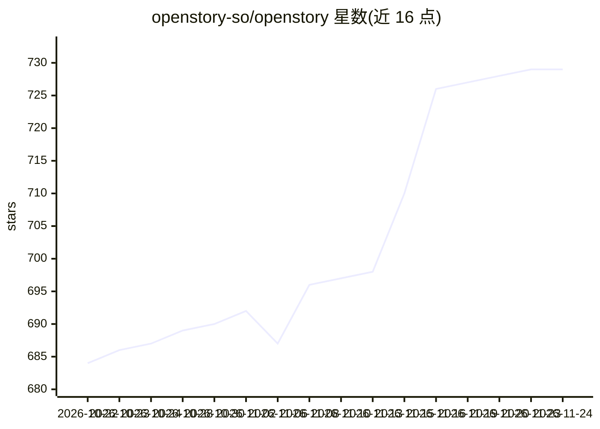

# openstory-so/openstory

⭐ 729 · TypeScript · MIT · 推送 2026-11-23 · [GitHub](https://github.com/openstory-so/openstory) · [官网](https://openstory.so) · 组织维护

**本地运行的开源 AI 影片生成工作室，脚本生成完整短片**

开源 AI 影片工作室：粘贴剧本或一句话简报，生成分镜一致的短片，包含同一角色的画面、配音与配乐。角色与场景通过参考图（sheet）在多个镜头间保持一致；每个镜头可独立切换生成模型（Seedance、Kling、Grok、Nano Banana 等）；所有产物以文件形式保存在 ~/openstory 并保留版本。用户自带各提供商 API key 并直接付费，同时可作为 MCP server 被 Claude、Cursor 等 agent 客户端驱动。依赖 Bun ≥1.3.9，无需 Docker、数据库或云账号，可部署到 Cloudflare。

## 筛选速览

| 维度 | 判定 | 备注 |
|---|---|---|
| AI 角色 | `ai-native` | 本体是模型或模型工具 |
| 许可风险 | `permissive` | MIT |
| 部署形态 | `library` | 以包/库形式分发 |
| 模型依赖 | locked-api |  |
| 硬件要求 | — | 无带数字的原话,不猜 |
| 安装摩擦 | `low` | 无编译、无系统依赖或容器化 |
| 成熟度 | — | 结构信号不足 |

## 能力要点

- 角色/场景参考图机制保持跨镜头一致性，含配音与唇形同步
- 每个镜头可独立切换生成模型（Seedance、Kling、Grok、Nano Banana 等）
- 既是 Web 应用也是 MCP server，可由 agent 客户端读取、编辑与生成
- 产物以可读文件存储于 ~/openstory，每个片段/配音/提示保留版本

## 适用场景

- 从剧本或一句话简报生成分镜连贯的短片
- 通过 Claude、Cursor 等 MCP 客户端自动编排与执行视频生成
- 本地文件管理影片资产并随时回退任意版本

## 场景标签

`视频生成` · 领域:内容生成

## 证据(README 行号)

> L5:  An open-source AI film studio that runs on your own machine.
> L6:  Paste a script. Get a film with the same characters in every shot, their voices, and a score.
> L100: OpenStory is also an MCP server. Point Claude, Cursor, Codex or any MCP client at `http://localhost:3000/mcp` and 

## 星数曲线

2026-10-22 684 → 2026-11-24 729（+45）

---
*卡片 v1 · prompt 1.4 · 生成 2026-11-24 · 置信度 high · 依据 README sha `e73e835d532d` · [字段定义](../../DATASET.md)*
