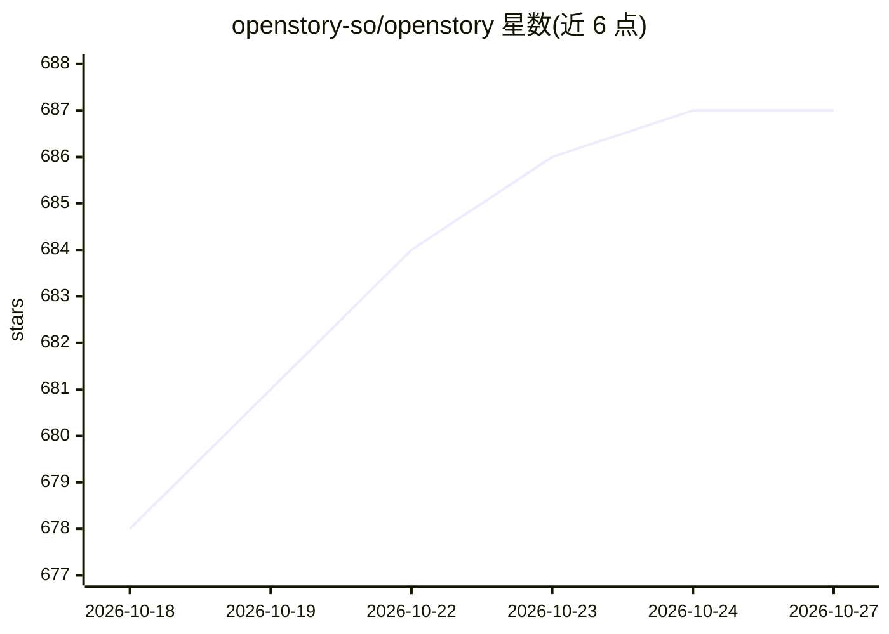

# openstory-so/openstory

⭐ 687 · TypeScript · MIT · 推送 2026-10-26 · [GitHub](https://github.com/openstory-so/openstory) · [官网](https://openstory.so) · 组织维护 · 中文 README

**将剧本转化为 AI 生成视频序列的开源平台**

基于 TanStack Start 与 Bun 构建的开源视频创作平台：粘贴剧本后自动做场景拆解（镜头角度、情绪、连贯性），调用 Fal.ai 生成图像、图生视频与音频，并保持跨场景风格一致；LLM 部分通过 OpenRouter 做剧本分析。支持 Passkey 登录、Cloudflare Workers 边缘部署与一键发布到 TikTok/YouTube 等社交平台；本地开发仅需 Bun，全栈经 Miniflare 运行，无需 Docker 或外部数据库。另提供 @openstory/stitch 本地播放器与 agent 技能插件。团队工作区标注为 coming soon。

## 筛选速览

| 维度 | 判定 | 备注 |
|---|---|---|
| AI 角色 | `ai-native` | 本体是模型或模型工具 |
| 许可风险 | `permissive` | MIT |
| 部署形态 | `library` | 以包/库形式分发 |
| 模型依赖 | locked-api |  |
| 硬件要求 | — | 无带数字的原话,不猜 |
| 安装摩擦 | `low` | 无编译、无系统依赖或容器化 |
| 成熟度 | `idea` | |

## 能力要点

- 剧本→场景拆解→AI 图像/视频/音频生成，跨场景风格一致
- Fal.ai 生成图像视频音频，OpenRouter 做剧本分析
- 本地开发仅需 Bun，D1/R2/Workflows 经 Miniflare 全栈运行
- 一键发布到 TikTok/Instagram/YouTube 等社交平台（自带 Upload-Post key）

## 适用场景

- 把写好的剧本自动生成为有配音与画面分镜的视频序列
- 团队协作维护共享的角色、场景与风格库（规划中）
- 将成片直接发布到多个社交媒体账号

## 场景标签

`视频生成` · 领域:内容生成

## 证据(README 行号)

> L5:  Transform scripts into styled video productions using AI.
> L18: - **AI image generation** — generate scene images via Fal.ai with multiple model options
> L66: - `FAL_KEY` — fal.ai for image, video & audio generation

## 星数曲线

2026-10-18 678 → 2026-10-27 687（+9）

---
*卡片 v1 · prompt 1.4 · 生成 2026-10-21 · 置信度 mid · 依据 README sha `0fb5f69260bd` · [字段定义](../../DATASET.md)*
