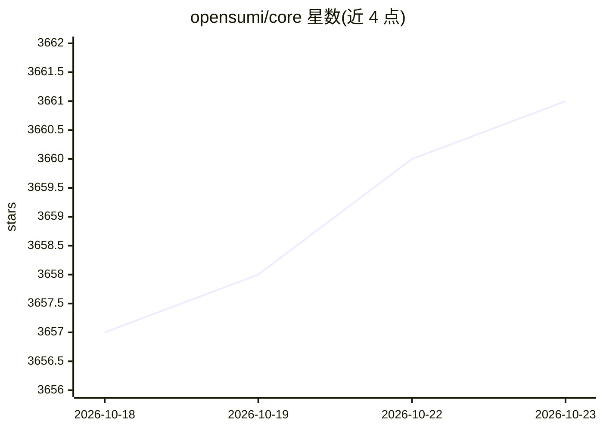

# opensumi/core

⭐ 3,661 · TypeScript · MIT · 推送 2026-10-15 · [GitHub](https://github.com/opensumi/core) · [官网](https://opensumi.com) · 组织维护 · 中文 README

**帮助快速构建 AI 原生 IDE 产品的框架**

由阿里巴巴/蚂蚁集团维护的 TypeScript IDE 框架，用于快速构建 AI Native IDE 产品，形态覆盖云端 IDE、基于 Electron 的桌面 IDE、纯浏览器 Web IDE 与小程序类 IDE。支持 MCP Client，可经 MCP server 接入 Model Context Protocol 工具。仓库提供示例项目与模板，通过 yarn 完成 install/init/start 开发流程，部分场景需自行准备系统级环境依赖；文档见 opensumi.com，以 npm 包分发，MIT 许可。

## 筛选速览

| 维度 | 判定 | 备注 |
|---|---|---|
| AI 角色 | `ai-ecosystem` | LLM/agent 周边工具 |
| 许可风险 | `permissive` | MIT |
| 部署形态 | `None` |  |
| 模型依赖 | — | README 未给出锁定关系 |
| 硬件要求 | — | 无带数字的原话,不猜 |
| 安装摩擦 | `low` | 无编译、无系统依赖或容器化 |
| 成熟度 | — | 结构信号不足 |

## 能力要点

- 面向 AI Native IDE 产品构建的框架
- 支持 MCP Client，经 MCP server 接入 MCP 工具
- 覆盖云端/桌面（Electron）/纯浏览器多种 IDE 形态的示例与模板

## 适用场景

- 基于框架搭建自定义的云端或桌面 IDE 产品
- 为 IDE 产品接入 MCP 工具生态
- 在纯浏览器环境运行轻量 Web IDE

## 场景标签

 · 领域:开发工具/IDE 框架

## 证据(README 行号)

> L3:  A framework helps you quickly build AI Native IDE products.
> L5: [![MCP][mcp-client-image]][mcp-client-url]

## 星数曲线

2026-10-18 3,657 → 2026-10-23 3,661（+4）

---
*卡片 v1 · prompt 1.4 · 生成 2026-10-20 · 置信度 high · 依据 README sha `0296d3b81da4` · [字段定义](../../DATASET.md)*
