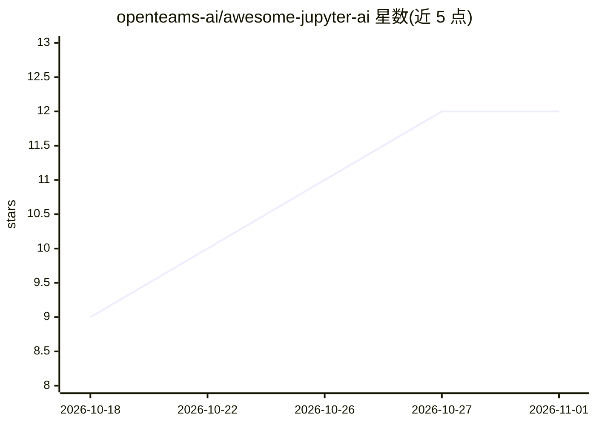

# openteams-ai/awesome-jupyter-ai

⭐ 12 · CC0-1.0 · 推送 2026-10-29 · [GitHub](https://github.com/openteams-ai/awesome-jupyter-ai) · 组织维护

**JupyterLab/Notebook 7 的 AI 扩展策展清单（百余条）**

收录 JupyterLab 与 Jupyter Notebook 7 的 AI 扩展清单，涵盖聊天面板与 agent、行内补全、单元格内编辑、agent CLI 桥接等类别，条目超过一百个。每个条目按活跃度标记（4 个月内/12 个月内/1-2 年前提交），更久未更新的项目与已归档项目移入 HISTORICAL.md。清单标注各扩展的许可证信息（如 Notebook Intelligence 为 GPL-3.0），并区分 Project Jupyter 官方维护项目与社区项目。面向在已有 JupyterLab 环境中选装 AI 扩展的开发者与科研用户。

## 筛选速览

| 维度 | 判定 | 备注 |
|---|---|---|
| AI 角色 | `ai-knowledge` | 知识聚合/清单类 |
| 许可风险 | `viral` | CC0-1.0 |
| 部署形态 | `self-host` | docker 或自建部署 |
| 模型依赖 | — | README 未给出锁定关系 |
| 硬件要求 | — | 无带数字的原话,不猜 |
| 安装摩擦 | `low` | 无编译、无系统依赖或容器化 |
| 成熟度 | — | 结构信号不足 |

## 能力要点

- 按功能分组的百余条 JupyterLab AI 扩展条目
- 按最后提交时间标记活跃度（active/maintained/quiet）
- 标注许可证差异（BSD-3-Clause/GPL-3.0/MIT/混合）
- 区分 Project Jupyter 官方、jupyter-ai-contrib 社区与个人项目

## 适用场景

- 为我的 JupyterLab 环境挑选 AI 聊天或补全扩展
- 了解 Jupyter 生态中 agent 类扩展的现状与活跃度
- 在分发前核对某扩展的许可证条款

## 场景标签

`精选清单` · 领域:学习与行业

## 证据(README 行号)

> L3: > AI extensions for JupyterLab and Jupyter Notebook 7 | Blog post
> L5: We are excited to see the Jupyter extension ecosystem thrive in the era of AI. The variety of ideas and implementati

## 星数曲线

2026-10-18 9 → 2026-11-01 12（+3）

---
*卡片 v1 · prompt 1.4 · 生成 2026-11-01 · 置信度 mid · 依据 README sha `52f0d36b5fc7` · [字段定义](../../DATASET.md)*
