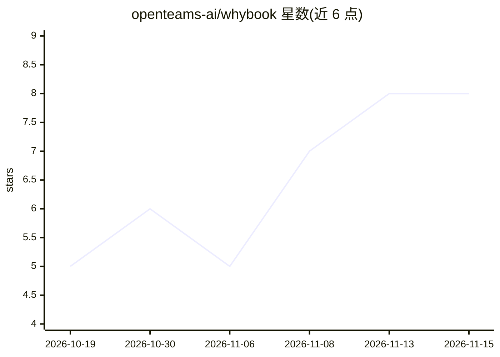

# openteams-ai/whybook

⭐ 10 · TypeScript · Apache-2.0 · 推送 2026-11-23 · [GitHub](https://github.com/openteams-ai/whybook) · [官网](https://whybook.dev) · 组织维护

**研究者向 JupyterLab 扩展：以提问驱动数据分析并披露每个结果的依据**

Whybook 是 JupyterLab 扩展，为笔记本提供一种提问式视图：分析师把列、变量或图表区域拖到单元格上，Whybook 提供最多 12 个五类问题（描述、数据质量、关联、因果、模型检查），多数由模板生成代码并直接运行，无需模型调用；需要 AI 的问题由 agent 生成并运行单元格，模型写的代码均有标记。所有常量、默认值与选择以 chip 形式展示。原型阶段，功能、设置与元数据可在不废弃的情况下变更。

## 筛选速览

| 维度 | 判定 | 备注 |
|---|---|---|
| AI 角色 | `ai-enhanced` | 去掉 AI 部分产品仍成立 |
| 许可风险 | `permissive` | Apache-2.0 |
| 部署形态 | `library` | 以包/库形式分发 |
| 模型依赖 | — | README 未给出锁定关系 |
| 硬件要求 | — | 无带数字的原话,不猜 |
| 安装摩擦 | `low` | 无编译、无系统依赖或容器化 |
| 成熟度 | `idea` | |

## 能力要点

- 五类问题模板多数无模型调用即可运行
- 拖拽/点击/框选图表区域触发问题建议
- 分支并行运行于独立 kernel subshell（JEP 91, ipykernel 7）
- 支持 all-local 设置拒绝任何远程模型，提示词中掩码密钥

## 适用场景

- 在笔记本中对某个列或图表区域提问并自动生成分析单元格
- 审查 AI 生成代码背后的常量、默认值与假设
- 在沙箱 kernel 中离线分析敏感数据，不将数据发送到远程模型

## 场景标签

`数据分析` `科研工具` · 领域:效率与自动化

## 证据(README 行号)

> L8: A research prototype that explores how to close the understanding gap in data analysis: the divide between what AI p
> L14: Whybook is a JupyterLab extension: a view of a Jupyter notebook for asking questions about data and understanding e

## 星数曲线

2026-10-19 5 → 2026-11-15 8（+3）

---
*卡片 v1 · prompt 1.4 · 生成 2026-11-24 · 置信度 high · 依据 README sha `01cd77867769` · [字段定义](../../DATASET.md)*
