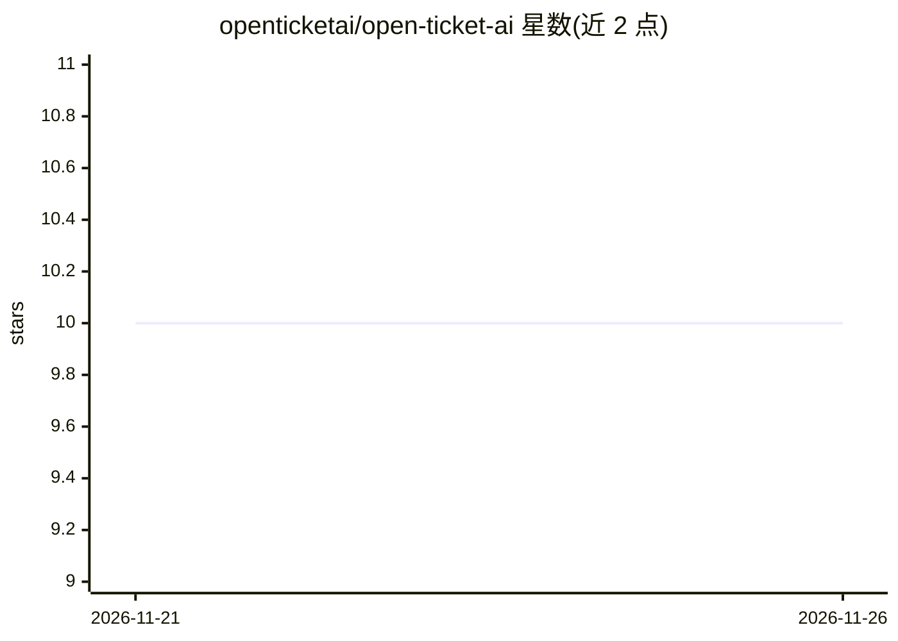

# openticketai/open-ticket-ai

⭐ 10 · Python · LGPL-2.1 · 推送 2026-09-18 · [GitHub](https://github.com/openticketai/open-ticket-ai) · [官网](https://openticketai.com) · 组织维护

**面向客服团队的开源工单 AI 分类与路由引擎**

on-premise 的工单自动化引擎，接入工单系统，通过机器学习自动分类、排序并路由支持工单，以插件化管道组织处理流程。核心包经 pip 安装，提供 Docker 镜像与 docker-compose 部署方式，可加装插件（如本地 HuggingFace 后端、OTobo/Znuny 连接器），支持源码方式参与开发，文档在官网，许可为 LGPL-2.1-only。

## 筛选速览

| 维度 | 判定 | 备注 |
|---|---|---|
| AI 角色 | `ai-native` | 本体是模型或模型工具 |
| 许可风险 | `viral` | LGPL-2.1 |
| 部署形态 | `self-host` | docker 或自建部署 |
| 模型依赖 | — | README 未给出锁定关系 |
| 硬件要求 | — | 无带数字的原话,不猜 |
| 安装摩擦 | `low` | 无编译、无系统依赖或容器化 |
| 成熟度 | — | 结构信号不足 |

## 能力要点

- 基于机器学习的工单自动分类与优先级排序
- 插件化管道处理架构，可加装 otai-* 插件扩展
- 提供 pip、Docker 镜像与 docker-compose 部署方式
- on-premise 部署，对接 OTobo/Znuny 等工单系统

## 适用场景

- 自动对客服工单分类并路由到对应处理队列
- 在自己服务器上本地部署工单自动化流程
- 通过插件对接已有 helpdesk 系统

## 场景标签

`工作流自动化` · 领域:效率与自动化

## 证据(README 行号)

> L6: description: Open Ticket AI is an intelligent ticket classification and routing system
> L17: Open Ticket AI is an intelligent ticket classification and routing system that uses machine learning to automatical

## 星数曲线

2026-11-21 10 → 2026-11-26 10（+0）

---
*卡片 v1 · prompt 1.4 · 生成 2026-11-21 · 置信度 high · 依据 README sha `7d44579d39ac` · [字段定义](../../DATASET.md)*
