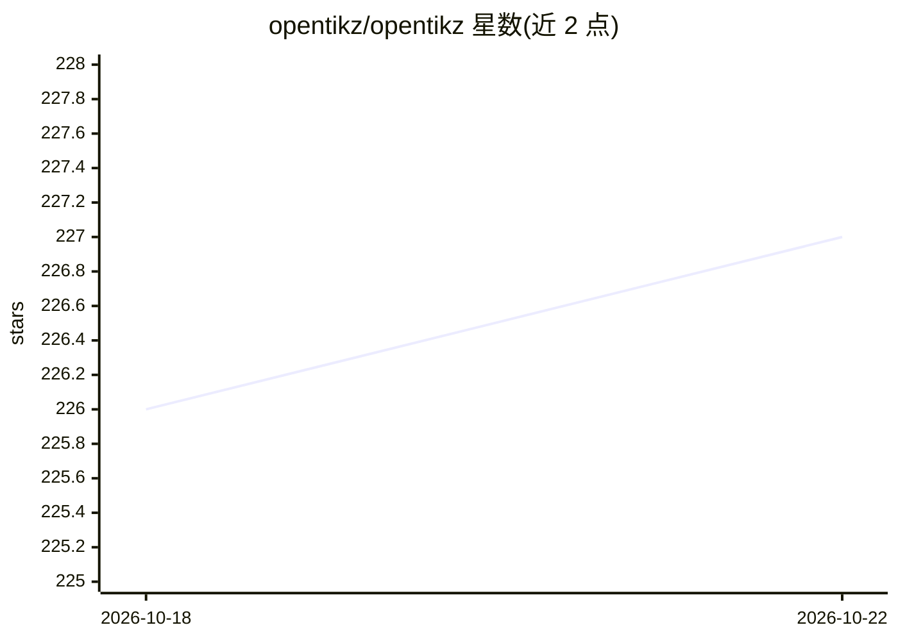

# opentikz/opentikz

⭐ 229 · TeX · NOASSERTION · 推送 2026-07-12 · [GitHub](https://github.com/opentikz/opentikz) · [官网](https://opentikz.org/) · 组织维护

**学术论文 TikZ 图示资源库：图标/模板 + AI agent 技能，免手写 TikZ**

面向论文写作者的 LaTeX TikZ 图示资源库，分三层组织：可独立复制编译的原子图标、带 edit_contract 的可编辑参数化模板、组合级示例；另含一个 SKILL.md 格式的 agent 技能，让 Claude Code 等 AI agent 完成找图→复制→按 edit_contract 编辑→编译验证的流程，支持描述生成 TikZ 与 PNG 转 TikZ。也可完全不用 AI，直接浏览画廊复制 .tex 源码。以 Claude Code 插件或 git clone 方式使用，代码 MIT、图形内容 CC0。

## 筛选速览

| 维度 | 判定 | 备注 |
|---|---|---|
| AI 角色 | `ai-knowledge` | 知识聚合/清单类 |
| 许可风险 | `none` | NOASSERTION |
| 部署形态 | `library` | 以包/库形式分发 |
| 模型依赖 | locked-api |  |
| 硬件要求 | — | 无带数字的原话,不猜 |
| 安装摩擦 | `low` | 无编译、无系统依赖或容器化 |
| 成熟度 | — | 结构信号不足 |

## 能力要点

- 图标/模板/示例三层结构，每个 .tex 均为 standalone 可独立编译
- 每个模板在 meta.json 中携带 edit_contract，供 agent 安全编辑
- SKILL.md 技能支持描述生成、模板编辑、PNG 转 TikZ 四种用法
- 提供 41 个工具/平台品牌图标及共享配色系统

## 适用场景

- 论文中快速获得可编辑的架构图/流程图/系统框图
- 让 Claude Code 等 agent 按描述起草或修改 TikZ 图并验证编译
- 直接复制图标或模板源码，不用 AI 也能用

## 场景标签

`编码 Agent` · 领域:编码与开发

## 证据(README 行号)

> L16: OpenTikZ is the "Flaticon for academic TikZ" — conceptual/overview figures
> L144: - **`skills/using-opentikz/`** — the one repo-wide skill that takes an AI agent

## 星数曲线

2026-10-18 226 → 2026-10-22 227（+1）

---
*卡片 v1 · prompt 1.4 · 生成 2026-10-22 · 置信度 low · 依据 README sha `87ff7b620e29` · [字段定义](../../DATASET.md)*
