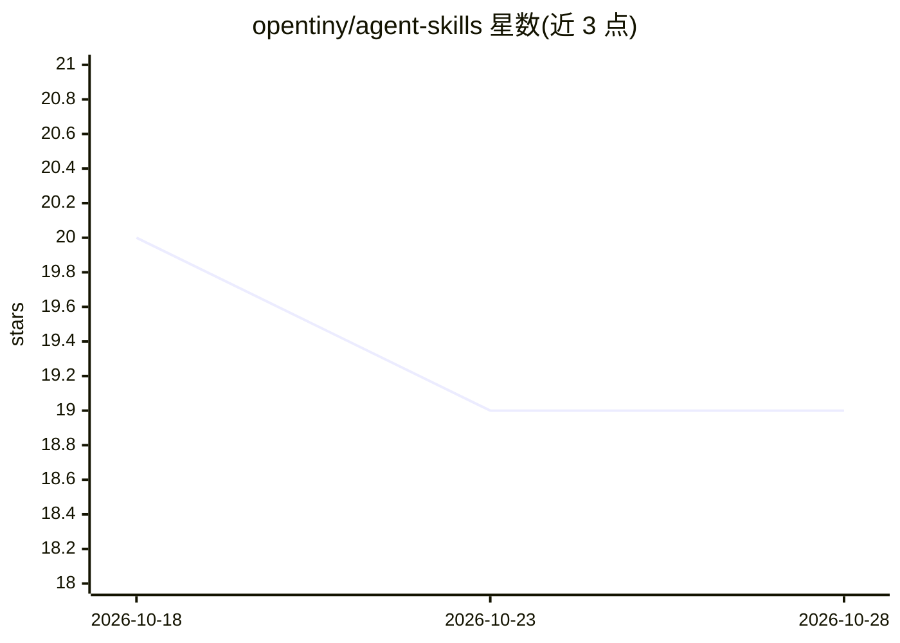

# opentiny/agent-skills

⭐ 19 · Vue · 推送 2026-09-17 · [GitHub](https://github.com/opentiny/agent-skills) · 组织维护 · 中文 README

**面向 AI IDE/CLI 的 OpenTiny 前端开发技能集合**

OpenTiny 维护的 agent 技能仓库，收录使用 TinyVue 等产品进行开发的 SKILL.md 技能，采用 Claude Code Plugin Marketplace 规范结构组织。提供四种安装途径：Claude Code 插件市场、vercel-labs 的 skills npm 工具、克隆复制到各 IDE 的 skills 目录（列出 Amp/Codex/Cursor/Copilot 等 16 种工具路径）、npx 直接安装（目前仅支持 tiny-vue-skill，需 Node 22+）。附同步 TinyVue 文档的 GitHub Action 与新技能添加流程说明。

## 筛选速览

| 维度 | 判定 | 备注 |
|---|---|---|
| AI 角色 | `ai-knowledge` | 知识聚合/清单类 |
| 许可风险 | `none` | — |
| 部署形态 | `library` | 以包/库形式分发 |
| 模型依赖 | — | README 未给出锁定关系 |
| 硬件要求 | — | 无带数字的原话,不猜 |
| 安装摩擦 | `low` | 无编译、无系统依赖或容器化 |
| 成熟度 | — | 结构信号不足 |

## 能力要点

- Claude Code Plugin Marketplace 规范结构的 SKILL.md 技能集合
- 四种安装方式覆盖 Claude Code 插件市场、npm skills 工具、克隆复制与 npx
- 给出 16 种 AI IDE/CLI 的技能放置路径对照表
- 提供同步最新 TinyVue 文档/示例的 GitHub Action

## 适用场景

- 在 Claude Code/Cursor/Copilot 等 AI 编码工具中使用 TinyVue 组件开发技能
- 让 AI IDE 按 TinyVue 规范生成表格、深色模式等前端功能
- 按规范结构为 OpenTiny 生态贡献新技能

## 场景标签

`提示工程` · 领域:Agent 开发

## 证据(README 行号)

> L3: 本仓库包含使用OpenTiny各产品开发相关的技能工具。
> L104: 在 `skills/your-skill-name/SKILL.md` 中定义技能：

## 星数曲线

2026-10-18 20 → 2026-10-28 19（-1）

---
*卡片 v1 · prompt 1.4 · 生成 2026-10-28 · 置信度 high · 依据 README sha `1eb89ab36ba2` · [字段定义](../../DATASET.md)*
