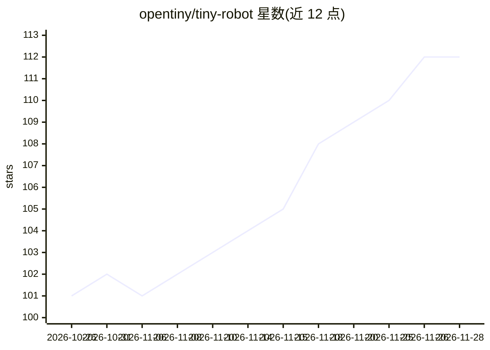

# opentiny/tiny-robot

⭐ 112 · TypeScript · MIT · 推送 2026-11-27 · [GitHub](https://github.com/opentiny/tiny-robot) · [官网](https://opentiny.design/tiny-robot) · 组织维护 · 中文 README

**面向开发者的 Vue 3 AI 对话组件库**

基于 Vue 3 + TypeScript、遵循 OpenTiny 设计系统的 AI 对话组件库与应用开发套件，包含组件库、完整 Chat 套件、数据层 Kit 与 CLI 四个可独立使用的包。提供聊天界面、流式响应、多会话管理、MCP 服务器管理与工具调用审批等能力；接入模型服务要求端点兼容 OpenAI chat API 格式。提供 CLI 创建项目、整套装安装或按需组合组件三种上手方式。

## 筛选速览

| 维度 | 判定 | 备注 |
|---|---|---|
| AI 角色 | `ai-ecosystem` | LLM/agent 周边工具 |
| 许可风险 | `permissive` | MIT |
| 部署形态 | `library` | 以包/库形式分发 |
| 模型依赖 | — | README 未给出锁定关系 |
| 硬件要求 | — | 无带数字的原话,不猜 |
| 安装摩擦 | `low` | 无编译、无系统依赖或容器化 |
| 成熟度 | — | 结构信号不足 |

## 能力要点

- Chat 套件：模型服务接入、流式响应、多会话管理与主题定制
- 支持工具调用展示、MCP 服务器管理与审批流程
- Kit 数据层支持 LocalStorage、IndexedDB 及自定义存储策略
- 提供 CLI 向已有 Vue 项目添加 Chat 能力

## 适用场景

- 为企业应用快速搭建智能对话界面
- 在已有 Vue 项目中集成完整聊天套件
- 按需组合组件与 Kit 自建 AI 聊天应用
- 在聊天应用中管理 MCP 服务器与工具调用

## 场景标签

`聊天机器人` · 领域:对话与助手

## 证据(README 行号)

> L12: **TinyRobot** is an AI component library and application development suite built with Vue 3 and following the OpenT
> L22: - **Tools and MCP**: Supports tool call display, MCP server management, tool selection, and approval workflows.
> L86: Replace `apiUrl` with your model service URL or a backend endpoint that forwards requests to the model service. The

## 星数曲线

2026-10-26 101 → 2026-11-28 112（+11）

---
*卡片 v1 · prompt 1.4 · 生成 2026-11-28 · 置信度 high · 依据 README sha `21b17161455c` · [字段定义](../../DATASET.md)*
