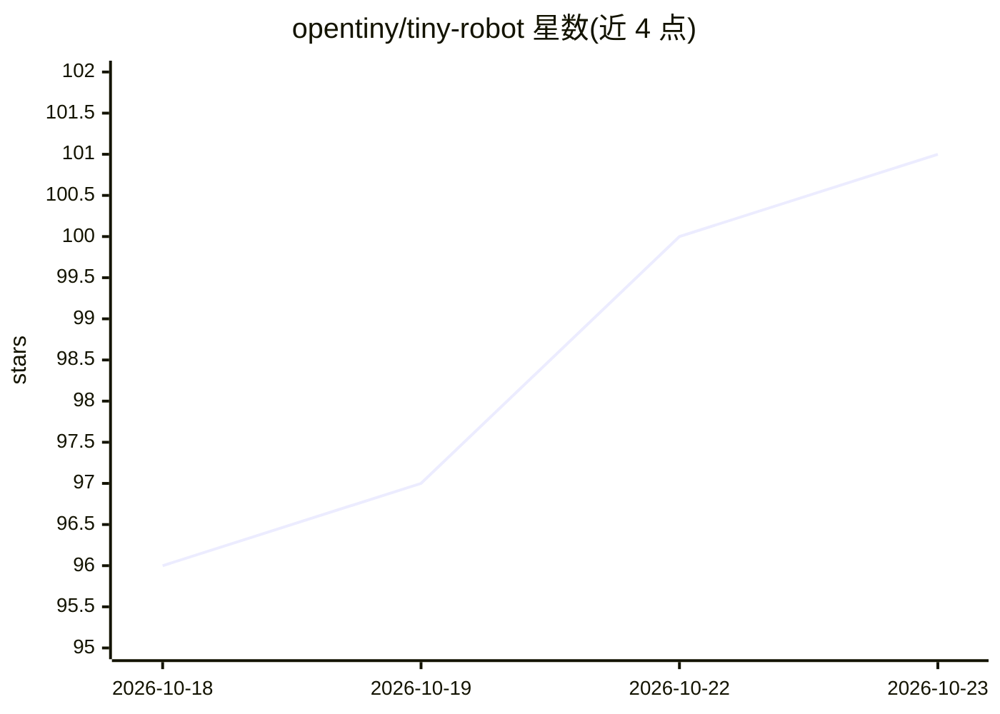

# opentiny/tiny-robot

⭐ 101 · TypeScript · MIT · 推送 2026-10-22 · [GitHub](https://github.com/opentiny/tiny-robot) · [官网](https://opentiny.design/tiny-robot) · 组织维护 · 中文 README

**面向 Vue 3 的 AI 对话组件库，助开发者构建企业级 AI 应用**

TinyRobot 是基于 Vue 3 的 AI 组件库，遵循 OpenTiny Design 设计体系，以 monorepo 形式提供三个 npm 包：核心组件库（聊天气泡、消息输入、会话管理等 AI 交互组件）、tiny-robot-kit（模型请求客户端与数据处理工具）和 tiny-robot-svgs（SVG 图标库）。内置流式响应支持与可配置存储策略（LocalStorage/IndexedDB/自定义），提供完整 TypeScript 类型定义、主题定制与 tree shaking。目标用户为构建企业级 AI 应用前端的前端开发者。要求 Node.js >= 20.13.0 与 Vue >= 3.2.0。

## 筛选速览

| 维度 | 判定 | 备注 |
|---|---|---|
| AI 角色 | `ai-ecosystem` | LLM/agent 周边工具 |
| 许可风险 | `permissive` | MIT |
| 部署形态 | `library` | 以包/库形式分发 |
| 模型依赖 | — | README 未给出锁定关系 |
| 硬件要求 | — | 无带数字的原话,不猜 |
| 安装摩擦 | `low` | 无编译、无系统依赖或容器化 |
| 成熟度 | — | 结构信号不足 |

## 能力要点

- Vue 3 AI 交互组件集：聊天气泡、消息输入、会话管理
- 内置流式 AI 响应支持与多存储策略（LocalStorage/IndexedDB/自定义）
- tiny-robot-kit 提供 AI 客户端工具用于模型交互
- TypeScript 类型定义、主题定制与 tree shaking

## 适用场景

- 在前端项目中搭建 AI 对话界面
- 为企业级应用集成流式 AI 问答交互
- 使用 tiny-robot-kit 连接模型处理请求与数据

## 场景标签

 · 领域:前端/AI 应用界面

## 证据(README 行号)

> L10: **TinyRobot** is an AI component library built for Vue 3, following the OpenTiny Design system. It provides rich AI
> L34: |`@opentiny/tiny-robot-kit`|Utility functions and AI client tools for model interactions|npm|
> L20: - 🔄 **Streaming Support**: Built-in support for streaming AI responses

## 星数曲线

2026-10-18 96 → 2026-10-23 101（+5）

---
*卡片 v1 · prompt 1.4 · 生成 2026-10-23 · 置信度 high · 依据 README sha `808be19f21a1` · [字段定义](../../DATASET.md)*
