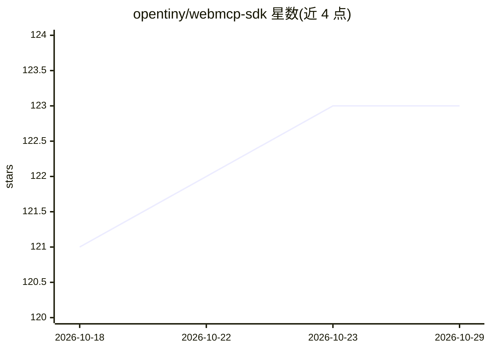

# opentiny/webmcp-sdk

⭐ 123 · TypeScript · MIT · 推送 2026-10-28 · [GitHub](https://github.com/opentiny/webmcp-sdk) · [官网](https://docs.opentiny.design/next-sdk/guide) · 组织维护 · 中文 README

**前端 WebMCP 工具包：让网页可被 AI Agent 感知与控制**

面向前端开发者与 AI Agent 构建者的工具包：实现 WebMCP 协议（浏览器版 MCP）与 Polyfill，注入 document.modelContext 使网页以标准化工具形式暴露给 AI，支持跨页面与 iframe 的消息桥接、远程 AI 控制及多种传输层（MessageChannel/SSE/HTTP/Chrome 扩展）。附带 webmcp-cli（基于 puppeteer-core 控制本地 Chrome 并自动注入 Polyfill，可将任意网页操作映射为 MCP 工具调用，无需修改源码）与 webmcp-skill（供 Claude/Gemini 等外部 LLM 学习使用 CLI 的技能规范）。另提供 Vue3 AI 聊天组件 @opentiny/next-remoter。限制：原生 WebMCP API 处于实验阶段，默认强制使用 JS Polyfill。

## 筛选速览

| 维度 | 判定 | 备注 |
|---|---|---|
| AI 角色 | `ai-ecosystem` | LLM/agent 周边工具 |
| 许可风险 | `permissive` | MIT |
| 部署形态 | `library` | 以包/库形式分发 |
| 模型依赖 | — | README 未给出锁定关系 |
| 硬件要求 | — | 无带数字的原话,不猜 |
| 安装摩擦 | `low` | 无编译、无系统依赖或容器化 |
| 成熟度 | `idea` | |

## 能力要点

- WebMCP 协议实现与 Polyfill：注入 document.modelContext，几行代码使网页成为 MCP Server
- webmcp-cli 基于 CDP 接管本地 Chrome，自动注入工具，零源码修改即可让 AI 遥控任意网页
- webmcp-skill 提供 SKILL.md 规范与领域子技能（如 Excalidraw 画布命令）
- 支持跨页面/iframe 消息桥接、持久会话 ID 与多种传输层

## 适用场景

- 让 AI Agent 通过标准化 MCP 协议调用我的网页应用功能
- 在不修改源码的情况下让 LLM 自动操作任意网页（点击、填表、搜索）
- 为文档站或企业应用添加带工具调用能力的智能问答
- 开发具备 AI 能力的浏览器扩展

## 场景标签

`浏览器自动化` · 领域:效率与自动化

## 证据(README 行号)

> L24: **OpenTiny NEXT-SDKs** is a front-end intelligent application development and browser automation toolkit. Beyond en
> L133: A CLI tool based on `puppeteer-core` used to control Chrome browsers and expose WebMCP interfaces:

## 星数曲线

2026-10-18 121 → 2026-10-29 123（+2）

---
*卡片 v1 · prompt 1.4 · 生成 2026-10-23 · 置信度 high · 依据 README sha `869018c22300` · [字段定义](../../DATASET.md)*
