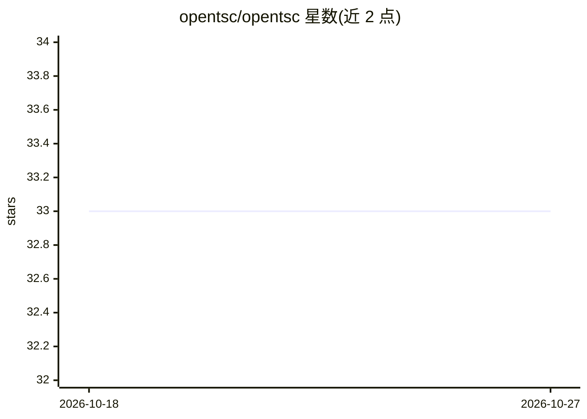

# opentsc/opentsc

⭐ 33 · Python · AGPL-3.0 · 推送 2026-06-24 · [GitHub](https://github.com/opentsc/opentsc) · [官网](https://dashen.wang) · 个人维护 · 中文 README

**本地离线的人际/项目/决策记忆系统，供 AI agent 调用**

面向个人用户的人际情报与决策记忆系统：以 Markdown 文件存储事件、人物与待办，每条事实标注来源与可信度；提供语义检索、身份去重、过期行动提醒与预测校准（记录预测并统计命中率）。形态为 AI 编程 agent 技能（Claude Code 等）加 Python 命令行工具，数据全部保存在本机，离线优先、单用户、无云端账户。可选启用中文分词（jieba）、情绪评分与向量索引（zvec），核心仅需 Python 即可运行。

## 筛选速览

| 维度 | 判定 | 备注 |
|---|---|---|
| AI 角色 | `ai-ecosystem` | LLM/agent 周边工具 |
| 许可风险 | `dual` | AGPL-3.0 |
| 部署形态 | `None` |  |
| 模型依赖 | — | README 未给出锁定关系 |
| 硬件要求 | — | 无带数字的原话,不猜 |
| 安装摩擦 | `low` | 无编译、无系统依赖或容器化 |
| 成熟度 | — | 结构信号不足 |

## 能力要点

- 事件记录带来源与可信度标注，存为用户自有的 Markdown 文件
- 自然语言经 agent 调用 event-add / index-search / identity-resolve 等命令
- stage-prediction → calibrate → accuracy 流程统计预测命中率
- 可选 jieba 中文分词、情绪评分与 zvec 向量记忆索引

## 适用场景

- 我记录同事和项目的进展，之后用自然语言查询谁靠谱、还欠我什么
- 我记录自己的判断并事后核对命中率
- 我在本机离线管理工作中的人际与运营记忆，不上云

## 场景标签

`Agent 记忆` `语义搜索` · 领域:Agent 开发

## 证据(README 行号)

> L40: OpenTSC is a **skill for AI coding agents** (Claude Code, and others) plus a **Python command-line tool**. You talk
> L43: python skill/scripts/opentsc.py --root my-vault init

## 星数曲线

2026-10-18 33 → 2026-10-27 33（+0）

---
*卡片 v1 · prompt 1.4 · 生成 2026-10-25 · 置信度 high · 依据 README sha `d5b69660da87` · [字段定义](../../DATASET.md)*
