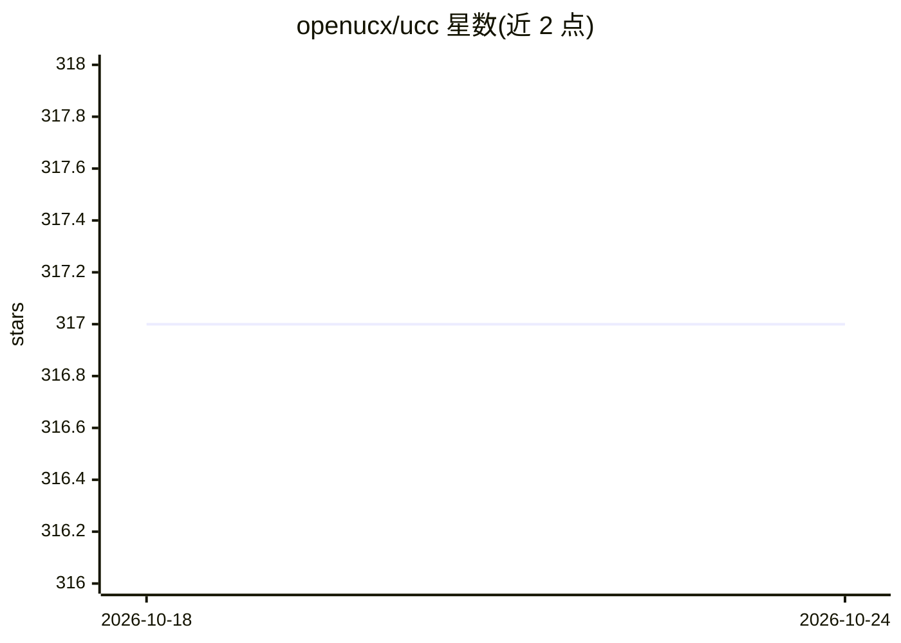

# openucx/ucc

⭐ 318 · C · BSD-3-Clause · 推送 2026-10-23 · [GitHub](https://github.com/openucx/ucc) · [官网](https://openucx.github.io/ucc/) · 组织维护

**面向 HPC/AI/ML 负载的集合通信操作 API 与库**

UCC 提供非阻塞集合通信操作 API 与库，设计目标覆盖高可扩展的 HPC、AI/ML 与 I/O 负载，支持多种编程模型、灵活资源分配、宽松排序与硬件集合通信。需依赖 UCX（使用其 UCS 组件工具），可选支持 CUDA 11.0+ 与 AMD HIP/ROCm。源码通过 autogen/configure/make 编译安装，可与 Open MPI 集成运行 MPI 与 OpenSHMEM 程序；支持的传输包括 UCX/UCP（InfiniBand、ROCE 等）、SHARP、CUDA、NCCL、RCCL、MLX5。以 C 库形式提供给 HPC 与分布式 AI 应用开发者使用。

## 筛选速览

| 维度 | 判定 | 备注 |
|---|---|---|
| AI 角色 | `ai-ecosystem` | LLM/agent 周边工具 |
| 许可风险 | `permissive` | BSD-3-Clause |
| 部署形态 | `None` |  |
| 模型依赖 | — | README 未给出锁定关系 |
| 硬件要求 | — | 无带数字的原话,不猜 |
| 安装摩擦 | `high` | 编译与系统依赖俱全 |
| 成熟度 | — | 结构信号不足 |

## 能力要点

- 非阻塞集合通信操作，覆盖多种编程模型与运行时
- 硬件集合通信为一级公民，支持 InfiniBand/ROCE/SHARP/CUDA/NCCL/RCCL/MLX5
- 可编译集成 Open MPI，运行 MPI 与 OpenSHMEM 程序
- 可选支持 NVIDIA CUDA 11.0+ 与 AMD HIP（ROCm）

## 适用场景

- HPC 集群上的 MPI/OpenSHMEM 集合通信加速
- 分布式 AI/ML 训练中替代或补充底层集合通信
- 利用 SHARP、NCCL 等硬件/库级集合通信通道

## 场景标签

 · 领域:HPC/分布式通信库

## 证据(README 行号)

> L3: UCC is a collective communication operations API and library that is flexible, complete, and feature-rich for curren
> L10: * Highly scalable and performant collectives for HPC, AI/ML and I/O workloads

## 星数曲线

2026-10-18 317 → 2026-10-24 317（+0）

---
*卡片 v1 · prompt 1.4 · 生成 2026-10-21 · 置信度 high · 依据 README sha `90269d476bbd` · [字段定义](../../DATASET.md)*
