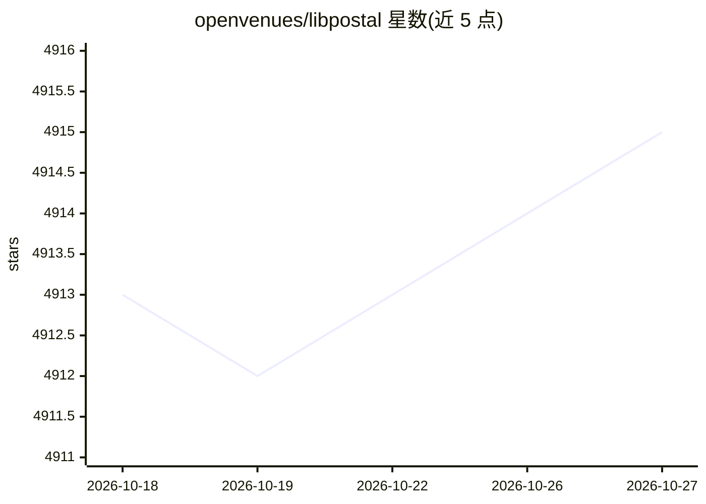

# openvenues/libpostal

⭐ 4,915 · C · MIT · 推送 2026-05-13 · [GitHub](https://github.com/openvenues/libpostal) · 组织维护

**全球街道地址解析/归一化的 C 库，供地理与数据清洗使用**

libpostal 是纯 C 编写的街道地址解析与归一化库，面向处理地图、配送、检索等位置字符串的开发者。解析器基于条件随机场（CRF），在超过 10 亿条地址（OpenStreetMap/OpenAddresses，覆盖 230+ 国家、100+ 语言）上训练；归一化 API（expand_address）内置 OSM 训练的语言分类器，支持 60+ 种语言的地址标准化。提供 Python、Ruby、Go、Java、PHP、NodeJS 官方绑定。限制：非完整地理编码器，仅作预处理；需从源码编译（Mac/Linux/Windows），数据目录需数 GB 空间；另有 Senzing 提供的替代数据模型（约 2.2GB）。

## 筛选速览

| 维度 | 判定 | 备注 |
|---|---|---|
| AI 角色 | `ai-native` | 本体是模型或模型工具 |
| 许可风险 | `permissive` | MIT |
| 部署形态 | `desktop` | 安装包/桌面程序 |
| 模型依赖 | — | README 未给出锁定关系 |
| 硬件要求 | — | 无带数字的原话,不猜 |
| 安装摩擦 | `medium` | 含编译或系统依赖之一 |
| 成熟度 | — | 结构信号不足 |

## 能力要点

- 基于 CRF 的地址解析器，训练数据超 10 亿条、覆盖 230+ 国家与 100+ 语言
- expand_address 归一化 API 支持 60+ 语言，含 OSM 训练的语言分类器
- 官方支持 Python/Ruby/Go/Java/PHP/NodeJS 六种语言绑定
- 可选 Senzing 替代数据模型（针对美英新地址优化）

## 适用场景

- 把用户输入的自由格式地址解析为结构化字段
- 将杂乱地址归一化以便做搜索索引、哈希与去重
- 作为地理编码应用的前处理步骤提升一致性

## 场景标签

 · 领域:地理 NLP/数据清洗

## 证据(README 行号)

> L9: libpostal is a C library for parsing/normalizing street addresses around the world using statistical NLP and open da
> L133: libpostal's international address parser uses machine learning (Conditional Random Fields) and is trained on over 

## 星数曲线

2026-10-18 4,913 → 2026-10-27 4,915（+2）

---
*卡片 v1 · prompt 1.4 · 生成 2026-10-20 · 置信度 high · 依据 README sha `594c1c66d7d8` · [字段定义](../../DATASET.md)*
