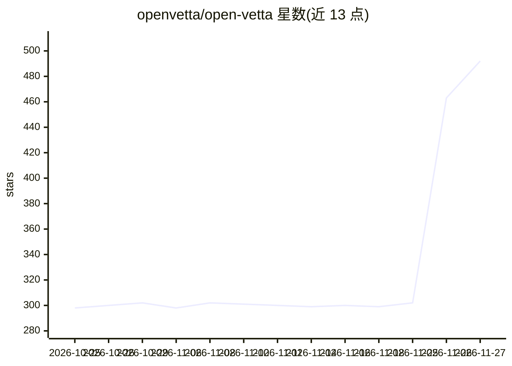

# openvetta/open-vetta

⭐ 492 · TypeScript · Apache-2.0 · 推送 2026-11-26 · [GitHub](https://github.com/openvetta/open-vetta) · [官网](https://www.openvetta.com) · 组织维护 · 中文 README

**本地优先的开源桌面 AI agent 工作区，处理编码与文档等真实任务**

Electron 桌面工作区，把模型、项目文件、本地工具与可复用能力整合到同一环境，供编码、文档、数据、研究与自动化工作流使用；agent 可检查工作区、在可见权限边界内调用工具、产出真实文件并保留执行轨迹供审查。BYOK 接入模型提供商或 OpenAI 兼容端点，lite 构建不依赖官方后端；通过 skill、MCP、plugin、theme、SDK/RPC/CLI 多层扩展，附 CLI、iOS 客户端与 IM 网关。

## 筛选速览

| 维度 | 判定 | 备注 |
|---|---|---|
| AI 角色 | `ai-native` | 本体是模型或模型工具 |
| 许可风险 | `permissive` | Apache-2.0 |
| 部署形态 | `library` | 以包/库形式分发 |
| 模型依赖 | — | README 未给出锁定关系 |
| 硬件要求 | — | 无带数字的原话,不猜 |
| 安装摩擦 | `low` | 无编译、无系统依赖或容器化 |
| 成熟度 | — | 结构信号不足 |

## 能力要点

- BYOK 接入提供商、OpenAI 兼容端点或本地推理
- 工具调用带可见权限边界与可审查执行轨迹
- Skill/MCP/Plugin/Theme/SDK 多层扩展模型
- lite 构建无官方后端依赖，凭据存本地

## 适用场景

- 在本地环境里让 agent 完成编码与文件产出任务
- 通过 MCP 和插件把外部工具接入 agent 工作流
- 用批处理任务把同一工作流跑在多个目录上
- 用 SDK/RPC/CLI 从其他程序驱动 agent

## 场景标签

`编码 Agent` `AI 助手` · 领域:编码与开发

## 证据(README 行号)

> L22: Open Vetta brings models, project files, local tools, and reusable capabilities into one desktop workspace. Use it 
> L24: It is more than a chat interface: Vetta can inspect a workspace, use tools with visible permission boundaries, prod
> L33: |**Bring your own models**|Connect supported providers, OpenAI-compatible endpoints, or local inference through BYO

## 星数曲线

2026-10-25 298 → 2026-11-27 492（+194）

---
*卡片 v1 · prompt 1.4 · 生成 2026-11-27 · 置信度 high · 依据 README sha `26a310c42aae` · [字段定义](../../DATASET.md)*
