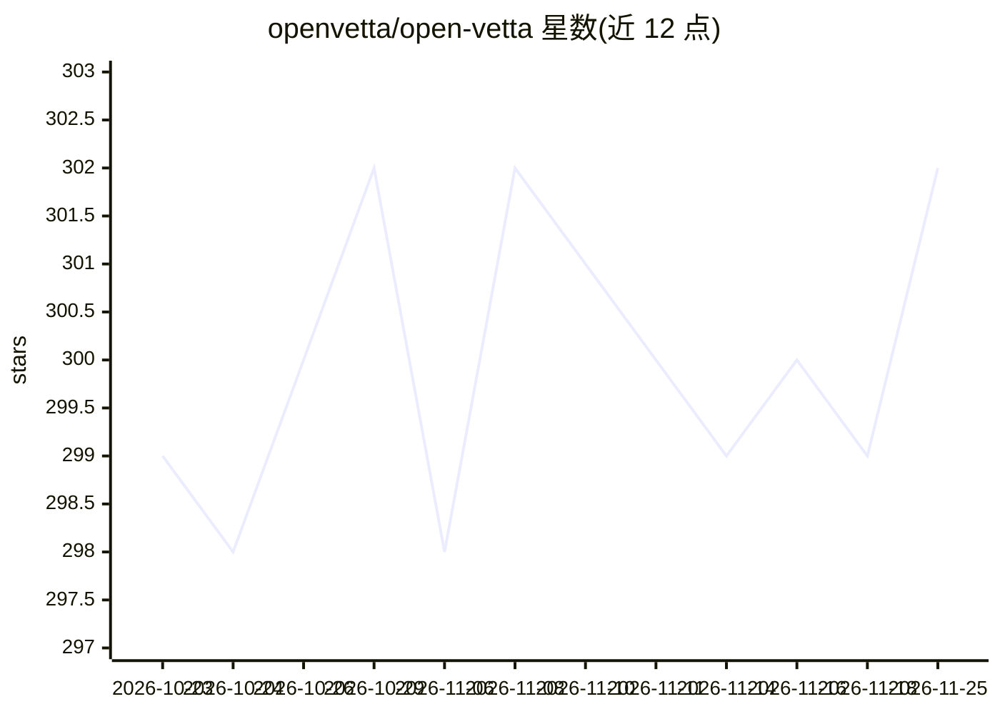

# openvetta/open-vetta

⭐ 302 · TypeScript · Apache-2.0 · 推送 2026-11-23 · [GitHub](https://github.com/openvetta/open-vetta) · [官网](https://www.openvetta.com) · 组织维护 · 中文 README

**开源本地优先桌面 AI agent 工作区：写代码与处理真实任务**

跨平台 Electron 桌面应用，将模型、项目文件、本地工具与可复用能力整合进单一工作区，覆盖编码、文档、数据、研究与自动化工作流。agent 可检视工作区、在可见权限边界内调用工具、产出真实文件并保留可审查的执行轨迹。扩展体系含 skill、MCP、plugin、theme 与 SDK/RPC/CLI；源码默认构建为不依赖官方后端的 lite 模式，模型请求指向用户自配端点（BYOK），凭据存于本地。安装包支持 macOS/Windows/Linux，源码运行需 Bun 1.3+ 与 Node.js 20+。

## 筛选速览

| 维度 | 判定 | 备注 |
|---|---|---|
| AI 角色 | `ai-native` | 本体是模型或模型工具 |
| 许可风险 | `permissive` | Apache-2.0 |
| 部署形态 | `library` | 以包/库形式分发 |
| 模型依赖 | — | README 未给出锁定关系 |
| 硬件要求 | — | 无带数字的原话,不猜 |
| 安装摩擦 | `low` | 无编译、无系统依赖或容器化 |
| 成熟度 | — | 结构信号不足 |

## 能力要点

- 本地优先工作区：项目、会话、文件与执行均在用户选择的环境中
- BYOK 接入受支持 provider、OpenAI 兼容端点或本地推理
- 多级扩展模型：skill、MCP、plugin、theme、SDK/RPC/CLI
- 工具调用、计划、权限与结果全程可见可审查

## 适用场景

- 在一个桌面工作区完成编码、文档处理与数据任务
- 通过 MCP 与插件接入外部工具和数据
- 将成熟流程以批处理或定时任务形式跨目录复用
- 构建本地知识库并安装可复用技能

## 场景标签

`编码 Agent` `工作流自动化` `AI 助手` · 领域:效率与自动化

## 证据(README 行号)

> L22: Open Vetta brings models, project files, local tools, and reusable capabilities into one desktop workspace. Use it 
> L24: It is more than a chat interface: Vetta can inspect a workspace, use tools with visible permission boundaries, prod
> L33: |**Bring your own models**|Connect supported providers, OpenAI-compatible endpoints, or local inference through BYO

## 星数曲线

2026-10-23 299 → 2026-11-25 302（+3）

---
*卡片 v1 · prompt 1.4 · 生成 2026-11-25 · 置信度 mid · 依据 README sha `670d541312e2` · [字段定义](../../DATASET.md)*
