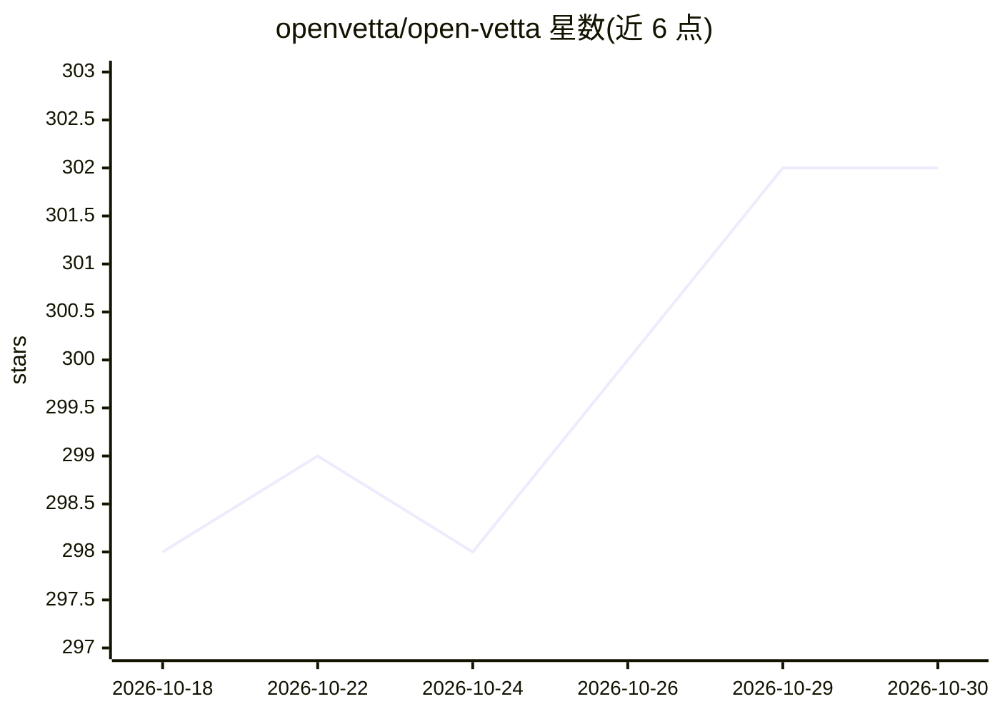

# openvetta/open-vetta

⭐ 302 · TypeScript · Apache-2.0 · 推送 2026-10-29 · [GitHub](https://github.com/openvetta/open-vetta) · [官网](https://www.openvetta.com) · 组织维护 · 中文 README

**本地优先的开源桌面 AI agent，用于编码与实际工作**

基于 Electron 的跨平台（macOS/Windows/Linux）桌面 AI agent 工作区：把模型、项目文件、本地工具与可复用能力集中在一处，支持 BYOK 接入各模型供应商、OpenAI 兼容端点或本地推理。Agent 可检查工作区、以可见权限边界调用工具、产出真实文件并保留可审查的执行轨迹。扩展层级覆盖 Skill、MCP、插件、主题、SDK/RPC/CLI；源码构建默认为 lite 版，不依赖官方后端。仓库还包含 CLI、移动端与 IM 网关。

## 筛选速览

| 维度 | 判定 | 备注 |
|---|---|---|
| AI 角色 | `ai-native` | 本体是模型或模型工具 |
| 许可风险 | `permissive` | Apache-2.0 |
| 部署形态 | `library` | 以包/库形式分发 |
| 模型依赖 | — | README 未给出锁定关系 |
| 硬件要求 | — | 无带数字的原话,不猜 |
| 安装摩擦 | `low` | 无编译、无系统依赖或容器化 |
| 成熟度 | — | 结构信号不足 |

## 能力要点

- BYOK 接入供应商、OpenAI 兼容端点或本地推理
- 工具调用、计划、权限与执行轨迹可审查
- Skill/MCP/插件/主题/SDK/RPC/CLI 多层级扩展模型
- 源码 lite 构建无需账号或托管后端，凭据存本地

## 适用场景

- 在本地桌面工作区让 AI agent 完成编码、文档、数据等实际任务
- 通过 MCP、插件与技能把 agent 接入自己的工具链
- 将成熟任务批量运行或定时自动化
- 构建私有知识库并在项目中复用组织知识

## 场景标签

`编码 Agent` `AI 助手` `知识库管理` · 领域:编码与开发

## 证据(README 行号)

> L22: Open Vetta brings models, project files, local tools, and reusable capabilities into one desktop workspace. Use it 
> L24: It is more than a chat interface: Vetta can inspect a workspace, use tools with visible permission boundaries, prod

## 星数曲线

2026-10-18 298 → 2026-10-30 302（+4）

---
*卡片 v1 · prompt 1.4 · 生成 2026-10-21 · 置信度 high · 依据 README sha `97623986898d` · [字段定义](../../DATASET.md)*
