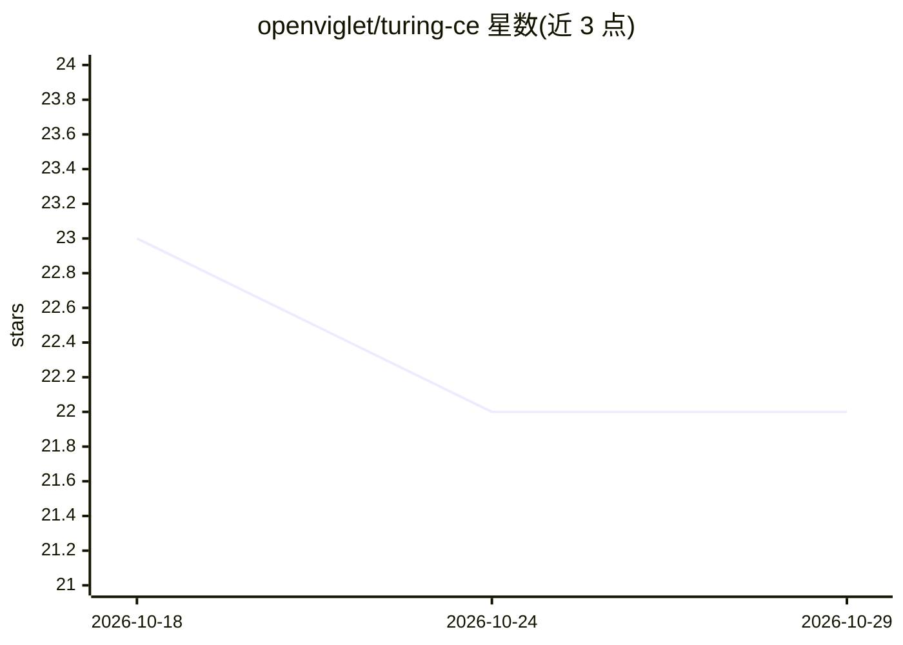

# openviglet/turing-ce

⭐ 22 · Java · Apache-2.0 · 推送 2026-10-28 · [GitHub](https://github.com/openviglet/turing-ce) · [官网](https://turing.viglet.org) · 组织维护

**自托管企业搜索与生成式 AI 平台，含 RAG 对话与 AI Agent**

Apache 2.0 许可的自托管企业搜索与生成式 AI 平台：提供分面语义搜索、BM25+向量混合排序（Reciprocal Rank Fusion 融合）、带引用的流式 RAG 回答、AI Agent 与 MCP 工具，后端可在 Apache Solr、Elasticsearch 或内嵌 Lucene 间切换。内容经配套的 Viglet Dumont 连接器或 REST 索引 API 从 Adobe AEM、WordPress、数据库与文件系统接入。面向需自建搜索的团队，支持离线运行（无需外部搜索引擎、向量库或 API key），提供 Docker、源码构建、Kubernetes 与安装包部署，技术栈为 Java 21 + Spring Boot 4 + React 19。

## 筛选速览

| 维度 | 判定 | 备注 |
|---|---|---|
| AI 角色 | `ai-ecosystem` | LLM/agent 周边工具 |
| 许可风险 | `permissive` | Apache-2.0 |
| 部署形态 | `desktop` | 安装包/桌面程序 |
| 模型依赖 | local-ok | 支持本地模型 |
| 硬件要求 | — | 无带数字的原话,不猜 |
| 安装摩擦 | `low` | 无编译、无系统依赖或容器化 |
| 成熟度 | — | 结构信号不足 |

## 能力要点

- BM25 + kNN 向量混合排序，Reciprocal Rank Fusion 融合与可插拔重排器
- 带内联来源引用的流式 RAG 回答
- 单一 API 覆盖 Solr/Elasticsearch/内嵌 Lucene 三种后端
- 默认内嵌 Lucene 索引，可完全离线运行，无需 API key

## 适用场景

- 给 AEM/WordPress/数据库内容建站内搜索并接入自己的应用
- 在自有基础设施上运行带引用的 RAG 问答
- 合规或离线环境下部署自托管搜索与 AI 层

## 场景标签

`RAG` `语义搜索` · 领域:知识与检索

## 证据(README 行号)

> L11: **Open-source enterprise search and generative AI platform.** Faceted semantic search, hybrid BM25 + vector ranking
> L63: | LLM for RAG
> L90: | BM25 keyword + kNN vector retrieval fused with Reciprocal Rank Fusion, plus pluggable rerankers

## 星数曲线

2026-10-18 23 → 2026-10-29 22（-1）

---
*卡片 v1 · prompt 1.4 · 生成 2026-10-27 · 置信度 high · 依据 README sha `6b742949f539` · [字段定义](../../DATASET.md)*
