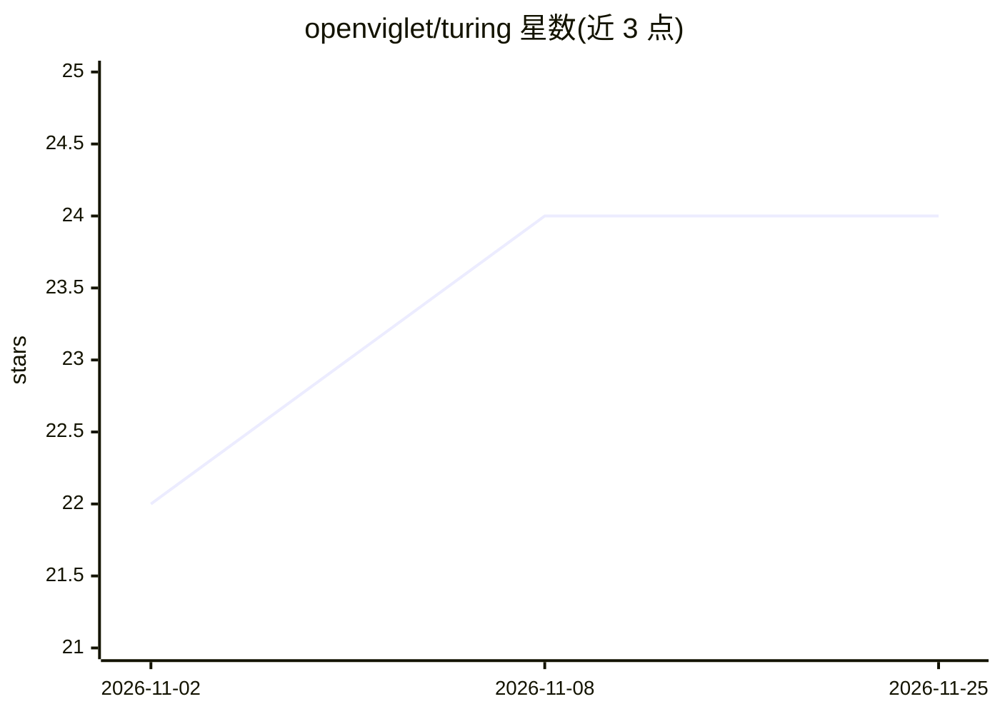

# openviglet/turing

⭐ 24 · Java · Apache-2.0 · 推送 2026-11-23 · [GitHub](https://github.com/openviglet/turing) · [官网](https://turing.viglet.org/) · 组织维护

**自托管企业搜索平台：分面语义搜索+带引用的 RAG 问答**

面向运行企业门户/网站、需要在自有服务器上做搜索与 AI 问答的团队。提供分面搜索、自动补全、BM25+kNN 混合排序（RRF 融合）、基于自有内容的流式 RAG 问答（带内联来源引用）以及可调用 MCP 服务器与原生工具的 AI Agent。后端可在 Apache Solr、Elasticsearch 或内嵌 Lucene 之间切换，LLM 可选 OpenAI/Anthropic/Gemini/Mistral/Cohere/Bedrock 或本地 Ollama。内容接入通过 REST/JSON 索引 API、Viglet Dumont 连接器或 WordPress 插件。Apache 2.0 许可，自称 Algolia/Coveo/Lucidworks 的自托管替代。

## 筛选速览

| 维度 | 判定 | 备注 |
|---|---|---|
| AI 角色 | `ai-ecosystem` | LLM/agent 周边工具 |
| 许可风险 | `permissive` | Apache-2.0 |
| 部署形态 | `desktop` | 安装包/桌面程序 |
| 模型依赖 | local-ok | 支持本地模型 |
| 硬件要求 | — | 无带数字的原话,不猜 |
| 安装摩擦 | `low` | 无编译、无系统依赖或容器化 |
| 成熟度 | — | 结构信号不足 |

## 能力要点

- BM25 关键词 + kNN 向量检索经 RRF 融合，支持可插拔重排器
- RAG 问答带内联来源引用，LLM 可选多家或本地 Ollama
- 同一 API 适配 Solr/Elasticsearch/内嵌 Lucene，内嵌索引可离线运行
- REST/GraphQL/SSE API，附 Java SDK（Maven Central）与 JS/TS SDK（npm）

## 适用场景

- 企业门户/网站在自有服务器上部署分面搜索与带引用的 AI 问答
- 替代按记录/查询计费的托管搜索 SaaS
- Adobe AEM 站点内容接入并构建站内搜索
- 隔离网络或合规环境下离线运行搜索与 RAG

## 场景标签

`RAG` `语义搜索` · 领域:知识与检索

## 证据(README 行号)

> L13: **Viglet Turing is open source enterprise search with generative AI.** Faceted semantic search, hybrid BM25 + vecto
> L39: Turing gives you both in one self-hosted platform: the search experience (facets,
> L41: agents, MCP), on the search engine you already run or on the embedded one.

## 星数曲线

2026-11-02 22 → 2026-11-25 24（+2）

---
*卡片 v1 · prompt 1.4 · 生成 2026-11-18 · 置信度 high · 依据 README sha `8729cadc8dcf` · [字段定义](../../DATASET.md)*
