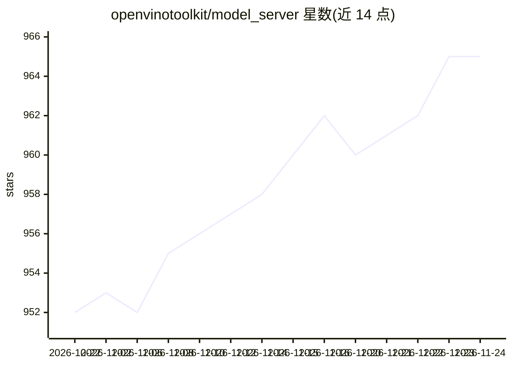

# openvinotoolkit/model_server

⭐ 965 · C++ · Apache-2.0 · 推送 2026-11-21 · [GitHub](https://github.com/openvinotoolkit/model_server) · [官网](https://docs.openvino.ai/2026/model-server/ovms_what_is_openvino_model_server.html) · 组织维护

**面向 Intel 硬件优化的模型推理服务：以网络 API 提供生成式与经典模型推理**

由 Intel 维护的 C++ 推理服务器（OVMS），通过 OpenAI 兼容 API 与 KServe API 对外提供 LLM 文本生成、嵌入、图像生成、音频、重排序，以及目标检测、分类、OCR 等经典模型推理。支持连续批处理、流式输出、投机解码、MCP agent、MediaPipe 图、模型热重载与 Prometheus 指标。部署方式包括 Docker、裸机（Linux/Windows）与 Kubernetes/OpenShift，模型仓库可位于本地、S3、GCS、Azure Blob 或 HuggingFace Hub。针对 Intel CPU/GPU/NPU 加速。

## 筛选速览

| 维度 | 判定 | 备注 |
|---|---|---|
| AI 角色 | `ai-ecosystem` | LLM/agent 周边工具 |
| 许可风险 | `permissive` | Apache-2.0 |
| 部署形态 | `desktop` | 安装包/桌面程序 |
| 模型依赖 | local-ok | 支持本地模型 |
| 硬件要求 | — | 无带数字的原话,不猜 |
| 安装摩擦 | `low` | 无编译、无系统依赖或容器化 |
| 成熟度 | — | 结构信号不足 |

## 能力要点

- OpenAI 兼容 API 覆盖文本生成、嵌入、图像生成与音频，另有 KServe API 服务经典模型
- 支持连续批处理、流式输出、结构化输出与投机解码
- 模型仓库支持本地、S3、GCS、Azure Blob 与 HuggingFace Hub，含版本管理与热重载
- 提供 C API 以嵌入原生应用，Prometheus 兼容指标与 gRPC 流式接口

## 适用场景

- 在 Intel CPU/GPU/NPU 环境部署 LLM 与视觉模型推理服务
- 以 OpenAI 兼容接口为生成式 AI 应用提供后端服务
- 在 Kubernetes/OpenShift 上规模化部署经典深度学习模型
- 搭建含检测、OCR、嵌入与重排序的多模型推理流水线

## 场景标签

`推理引擎` · 领域:训练与推理

## 证据(README 行号)

> L12: OpenVINO Model Server (OVMS) is a production-grade, C++ inference server that exposes ML models over standard netwo
> L16: - **Runs anywhere** — Docker, bare metal, Kubernetes/OpenShift, Windows
> L116: - CPU (x86, including Xeon), Intel integrated and discrete GPU, NPU

## 星数曲线

2026-10-22 952 → 2026-11-24 965（+13）

---
*卡片 v1 · prompt 1.4 · 生成 2026-11-24 · 置信度 mid · 依据 README sha `e241f6c42a23` · [字段定义](../../DATASET.md)*
