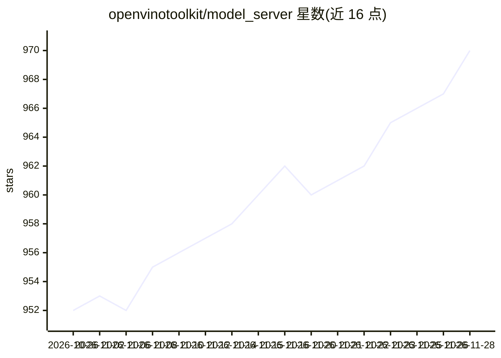

# openvinotoolkit/model_server

⭐ 970 · C++ · Apache-2.0 · 推送 2026-11-27 · [GitHub](https://github.com/openvinotoolkit/model_server) · [官网](https://docs.openvino.ai/2026/model-server/ovms_what_is_openvino_model_server.html) · 组织维护

**面向开发者托管推理 OpenVINO 优化模型的服务器**

OVMS 是一个 C++ 实现的模型推理服务器，通过网络 API 提供经 OpenVINO 优化的模型服务：面向生成式 AI 工作负载提供 OpenAI 兼容的文本生成、嵌入、图像生成与音频接口，面向传统深度学习模型提供 KServe 接口。支持 Docker、裸机、Kubernetes/OpenShift 部署，模型仓库支持本地存储、S3、GCS、Azure Blob 与 HuggingFace Hub，提供模型版本管理、热重载与 Prometheus 指标。硬件加速针对 Intel CPU（含 Xeon）、GPU 与 NPU，Linux 与 Windows 提供官方二进制包。

## 筛选速览

| 维度 | 判定 | 备注 |
|---|---|---|
| AI 角色 | `ai-ecosystem` | LLM/agent 周边工具 |
| 许可风险 | `permissive` | Apache-2.0 |
| 部署形态 | `desktop` | 安装包/桌面程序 |
| 模型依赖 | local-ok | 支持本地模型 |
| 硬件要求 | — | 无带数字的原话,不猜 |
| 安装摩擦 | `low` | 无编译、无系统依赖或容器化 |
| 成熟度 | — | 结构信号不足 |

## 能力要点

- OpenAI 兼容 API：文本生成、嵌入、图像生成、音频，另支持 Cohere 兼容 reranking
- KServe API 服务传统模型（TensorFlow/ONNX/PaddlePaddle/OpenVINO IR 格式）
- LLM 服务特性：continuous batching、流式输出、结构化输出、speculative decoding
- 支持 MediaPipe 图、Python 执行节点、模型热重载与 gRPC streaming

## 适用场景

- 在 Intel CPU/GPU/NPU 上部署 LLM 与多模态推理服务
- 通过 Kubernetes 集群化托管目标检测、分类、OCR 等传统模型
- 以 OpenAI 兼容接口为现有应用接入本地推理后端

## 场景标签

`推理引擎` · 领域:训练与推理

## 证据(README 行号)

> L12: OpenVINO Model Server (OVMS) is a production-grade, C++ inference server that exposes ML models over standard netwo
> L16: - **Runs anywhere** — Docker, bare metal, Kubernetes/OpenShift, Windows
> L108: - Docker, bare metal (Linux & Windows), Kubernetes / OpenShift

## 星数曲线

2026-10-26 952 → 2026-11-28 970（+18）

---
*卡片 v1 · prompt 1.4 · 生成 2026-11-26 · 置信度 mid · 依据 README sha `4e886cfa8415` · [字段定义](../../DATASET.md)*
