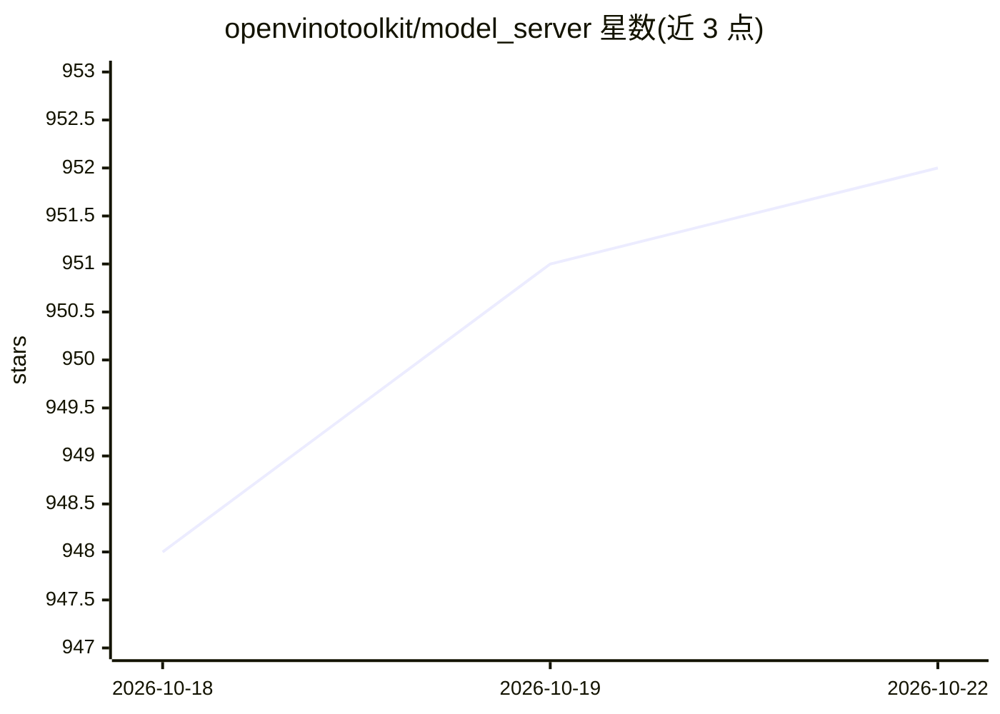

# openvinotoolkit/model_server

⭐ 952 · C++ · Apache-2.0 · 推送 2026-10-22 · [GitHub](https://github.com/openvinotoolkit/model_server) · [官网](https://docs.openvino.ai/2026/model-server/ovms_what_is_openvino_model_server.html) · 组织维护

**OpenVINO 驱动的生产级推理服务，面向 GenAI 与经典深度学习模型**

C++ 实现的模型服务进程，通过 OpenAI 兼容 API 与 KServe API 在网络中暴露 ML 模型：支持 LLM 文本生成（连续批处理、流式、结构化输出、投机解码）、VLM、文本嵌入、重排、图像生成、语音识别与 TTS，以及 TensorFlow/ONNX/PaddlePaddle/OpenVINO IR 等经典模型格式。可部署于 Docker、裸机（Linux/Windows）、Kubernetes/OpenShift，模型仓库支持本地存储、S3、GCS、Azure Blob 与 HuggingFace Hub，提供模型版本管理与热加载。硬件加速面向 Intel CPU/GPU/NPU。由 Intel 旗下 openvinotoolkit 组织维护，Apache 许可证。

## 筛选速览

| 维度 | 判定 | 备注 |
|---|---|---|
| AI 角色 | `ai-ecosystem` | LLM/agent 周边工具 |
| 许可风险 | `permissive` | Apache-2.0 |
| 部署形态 | `desktop` | 安装包/桌面程序 |
| 模型依赖 | — | README 未给出锁定关系 |
| 硬件要求 | — | 无带数字的原话,不猜 |
| 安装摩擦 | `low` | 无编译、无系统依赖或容器化 |
| 成熟度 | — | 结构信号不足 |

## 能力要点

- OpenAI 兼容 API（文本生成/嵌入/图像生成/音频）与 KServe API 双通道
- LLM 服务特性：连续批处理、流式输出、结构化输出、投机解码、GGUF 模型支持
- 模型仓库支持 S3/GCS/Azure Blob/HuggingFace Hub，含版本管理与热加载
- 支持 Docker、裸机（Linux/Windows）、Kubernetes/OpenShift 部署，提供 Prometheus 指标

## 适用场景

- 在生产环境部署 LLM/VLM 并通过 OpenAI 兼容 API 供客户端调用
- 在 Kubernetes 集群中服务经典视觉模型（检测/分类/OCR）
- 在 Intel CPU/GPU/NPU 硬件上运行推理服务

## 场景标签

`推理引擎` · 领域:训练与推理

## 证据(README 行号)

> L12: OpenVINO Model Server (OVMS) is a production-grade, C++ inference server that exposes ML models over standard netwo
> L15: - **KServe** APIs for classic model inference

## 星数曲线

2026-10-18 948 → 2026-10-22 952（+4）

---
*卡片 v1 · prompt 1.4 · 生成 2026-10-21 · 置信度 mid · 依据 README sha `f4098cf9bd7e` · [字段定义](../../DATASET.md)*
