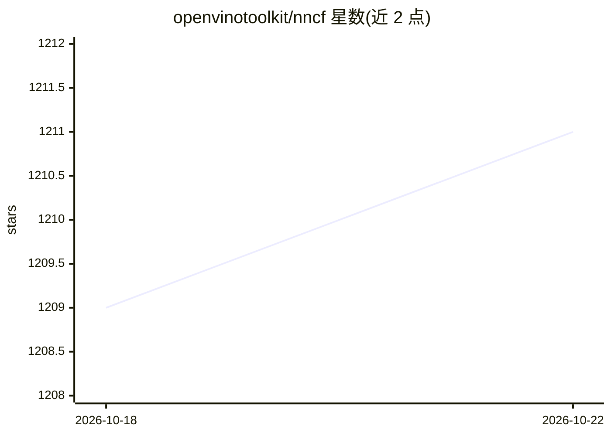

# openvinotoolkit/nncf

⭐ 1,211 · Python · Apache-2.0 · 推送 2026-10-19 · [GitHub](https://github.com/openvinotoolkit/nncf) · 组织维护

**面向 OpenVINO 推理的神经网络压缩框架，服务开发者优化模型**

OpenVINO 工具套件配套的 Python 压缩框架，提供训练后量化、权重压缩、量化感知训练（含 LoRA/NLS）、剪枝等算法，作用于 PyTorch、TorchFX、ONNX 与 OpenVINO 模型，以最小精度损失换取推理加速。PTQ 仅需模型与约 300 条校准样本；支持分布式训练与 GPU 加速层，可导出 ONNX/SavedModel 供 OpenVINO 使用。被 HuggingFace Optimum Intel、ExecuTorch、torch.compile、Microsoft Olive 等用作量化后端。

## 筛选速览

| 维度 | 判定 | 备注 |
|---|---|---|
| AI 角色 | `ai-ecosystem` | LLM/agent 周边工具 |
| 许可风险 | `permissive` | Apache-2.0 |
| 部署形态 | `library` | 以包/库形式分发 |
| 模型依赖 | — | README 未给出锁定关系 |
| 硬件要求 | — | 无带数字的原话,不猜 |
| 安装摩擦 | `low` | 无编译、无系统依赖或容器化 |
| 成熟度 | — | 结构信号不足 |

## 能力要点

- 训练后量化（含精度控制）仅需模型与约 300 条校准样本
- 支持 PyTorch/TorchFX/ONNX/OpenVINO 四种后端
- 量化感知训练（含 Weight-Only QAT + LoRA/NLS）、剪枝算法
- 被 Optimum Intel、ExecuTorch、Microsoft Olive 集成为量化后端

## 适用场景

- 把 LLM 权重量化为 INT4 以在 OpenVINO 上部署
- 对检测/分类/分割模型做 8-bit 训练后量化加速推理
- 在自有 PyTorch 训练管线中集成量化感知训练

## 场景标签

`模型量化` · 领域:训练与推理

## 证据(README 行号)

> L20: Neural Network Compression Framework (NNCF) provides a suite of post-training and training-time algorithms for
> L21: optimizing inference of neural networks in OpenVINO&trade; with a minimal accuracy drop.

## 星数曲线

2026-10-18 1,209 → 2026-10-22 1,211（+2）

---
*卡片 v1 · prompt 1.4 · 生成 2026-10-21 · 置信度 high · 依据 README sha `bb58a34b38fb` · [字段定义](../../DATASET.md)*
