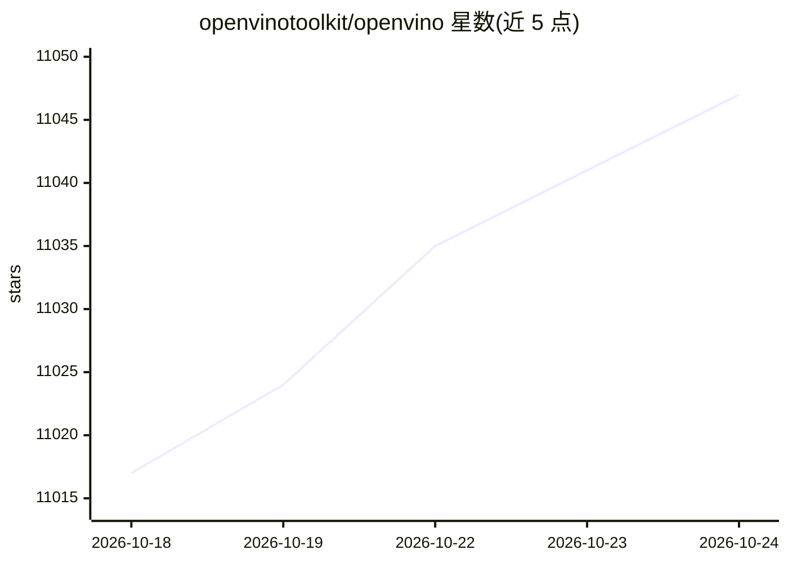

# openvinotoolkit/openvino

⭐ 11,062 · C++ · Apache-2.0 · 推送 2026-10-23 · [GitHub](https://github.com/openvinotoolkit/openvino) · [官网](https://docs.openvino.ai) · 组织维护

**深度学习模型优化与推理部署工具包**

OpenVINO 是 Intel 维护的开源工具包，面向开发者将深度学习模型优化后部署到从边缘到云的多种硬件。支持读取 PyTorch、TensorFlow、ONNX、PaddlePaddle、JAX/Flax 等框架训练的模型并转换部署，可在 CPU（x86/ARM）、Intel GPU 与 NPU 上运行推理。提供 C++/Python/C/NodeJS API，附 GenAI API 用于 LLM 与生成式模型管线，另有 NNCF 量化压缩等配套工具。经 pip 安装，Apache 2.0 许可。

## 筛选速览

| 维度 | 判定 | 备注 |
|---|---|---|
| AI 角色 | `ai-ecosystem` | LLM/agent 周边工具 |
| 许可风险 | `permissive` | Apache-2.0 |
| 部署形态 | `library` | 以包/库形式分发 |
| 模型依赖 | local-ok | 支持本地模型 |
| 硬件要求 | — | 无带数字的原话,不猜 |
| 安装摩擦 | `low` | 无编译、无系统依赖或容器化 |
| 成熟度 | — | 结构信号不足 |

## 能力要点

- 转换并部署 PyTorch/TensorFlow/ONNX/PaddlePaddle/JAX/Flax 模型，无需原始框架
- 支持 CPU（x86/ARM）、Intel GPU 与 NPU 推理
- 提供 C++/Python/C/NodeJS API 及 GenAI API 优化生成式模型管线
- 配套 NNCF 量化/稀疏化等模型优化工具与 vLLM/ONNX Runtime 等集成

## 适用场景

- 将训练好的视觉或语言模型优化后部署到边缘设备
- 在 Intel CPU/GPU/NPU 上运行 LLM 与生成式 AI 推理
- 对现有 PyTorch/TensorFlow 代码接入 OpenVINO 后端提升推理性能

## 场景标签

`推理引擎` `模型量化` · 领域:训练与推理

## 证据(README 行号)

> L3: Open-source software toolkit for optimizing and deploying deep learning models.
> L18: - **Broad Platform Compatibility**: Reduce resource demands and efficiently deploy on a range of platforms from edg

## 星数曲线

2026-10-18 11,017 → 2026-10-24 11,047（+30）

---
*卡片 v1 · prompt 1.4 · 生成 2026-10-20 · 置信度 high · 依据 README sha `384b0fd7ed84` · [字段定义](../../DATASET.md)*
