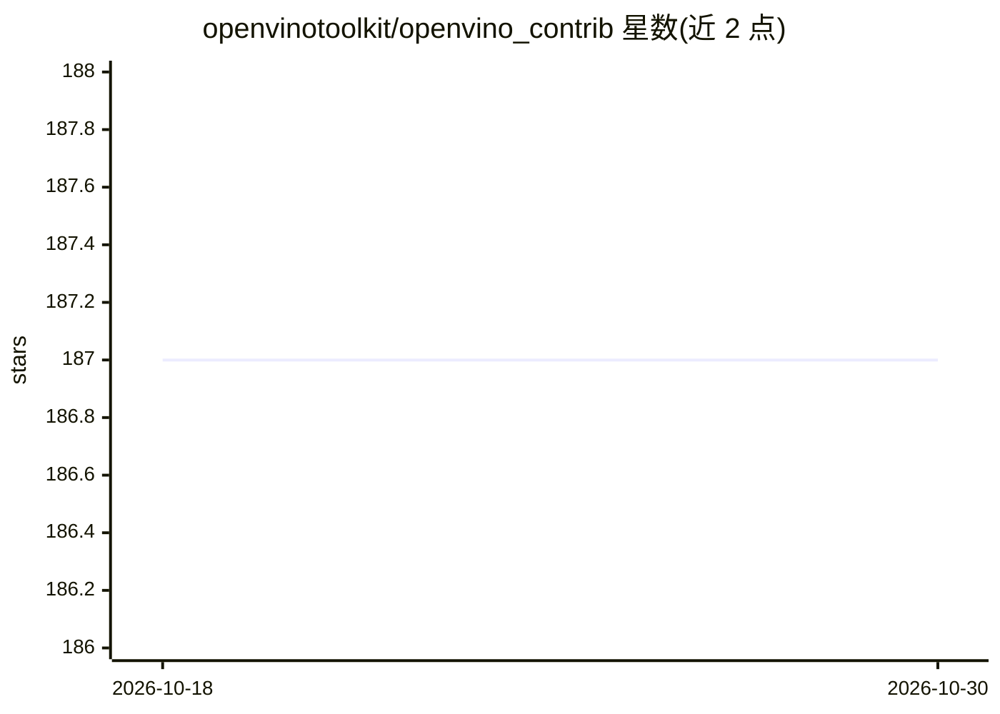

# openvinotoolkit/openvino_contrib

⭐ 187 · C++ · Apache-2.0 · 推送 2026-10-28 · [GitHub](https://github.com/openvinotoolkit/openvino_contrib) · 组织维护

**OpenVINO 官方扩展模块仓库：NVIDIA 插件、Java/Rust API 等贡献模块**

OpenVINO 的贡献模块仓库，收录尚未进入官方发行版、API 可能不稳定的扩展功能，模块成熟后可移入主仓库。包含 NVIDIA GPU 的 CUDA 推理插件、OpenVINO Java/Rust API、自定义算子集合、Token Merging 适配、Ollama-OpenVINO（在 Intel 平台加速 LLM）、VSCode AI 补全扩展、训练工具包、BEVFusion/FlashOCC/3D 视觉模型实现等。通过 CMake 与 OpenVINO 源码一起构建，可按模块开关启用。模块明确声明缺乏稳定 API、测试不足。

## 筛选速览

| 维度 | 判定 | 备注 |
|---|---|---|
| AI 角色 | `ai-ecosystem` | LLM/agent 周边工具 |
| 许可风险 | `permissive` | Apache-2.0 |
| 部署形态 | `None` |  |
| 模型依赖 | local-ok | 支持本地模型 |
| 硬件要求 | — | 无带数字的原话,不猜 |
| 安装摩擦 | `high` | 编译与系统依赖俱全 |
| 成熟度 | `idea` | |

## 能力要点

- NVIDIA GPU 插件：经 CUDA 用 OpenVINO API 在 NVIDIA GPU 上做推理
- Java/Rust 语言绑定与自定义算子扩展机制
- Ollama-OpenVINO：Intel CPU/iGPU/dGPU/NPU 上加速 LLM
- 3D 视觉模型（PointPillars 检测、CDPN 位姿估计）实现

## 适用场景

- 为 OpenVINO 添加 NVIDIA CUDA 后端或 Java/Rust 绑定
- 在 Intel 平台上用 OpenVINO 加速本地 Ollama LLM 推理
- 使用或开发尚未进入官方发行版的 OpenVINO 扩展模块

## 场景标签

`推理引擎` · 领域:训练与推理

## 证据(README 行号)

> L3: This repository is intended for the development of so-called "extra" modules, contributed functionality. New modules
> L11: * **nvidia_plugin**: NVIDIA GPU Plugin -- allows to perform deep neural networks inference on NVIDIA GPUs using CUD

## 星数曲线

2026-10-18 187 → 2026-10-30 187（+0）

---
*卡片 v1 · prompt 1.4 · 生成 2026-10-22 · 置信度 high · 依据 README sha `19346a3ff16d` · [字段定义](../../DATASET.md)*
