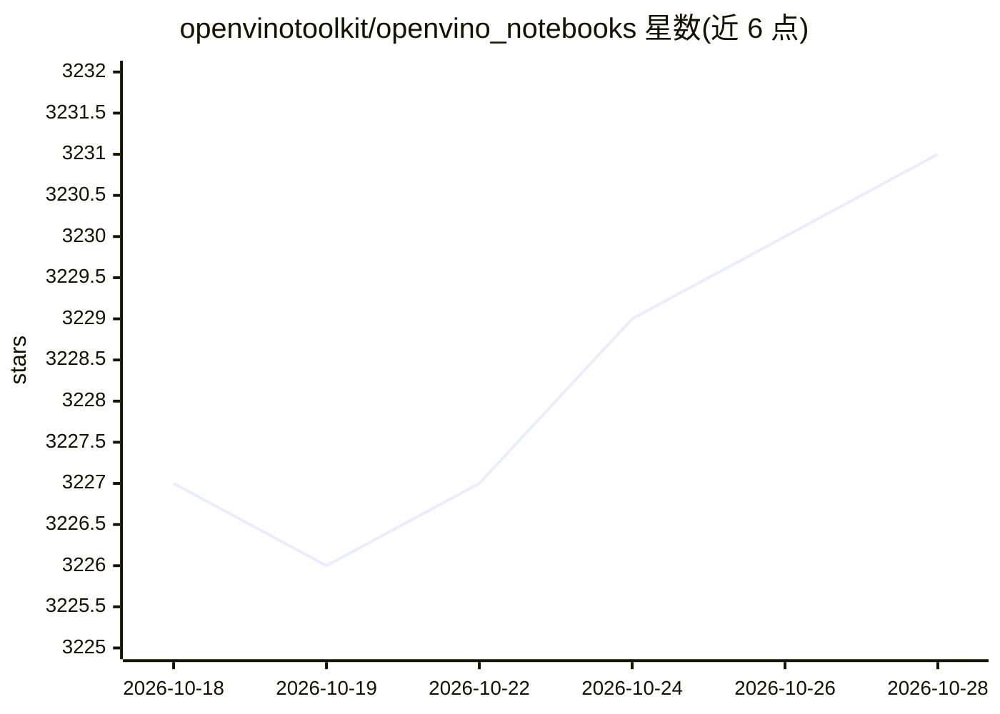

# openvinotoolkit/openvino_notebooks

⭐ 3,231 · Jupyter Notebook · Apache-2.0 · 推送 2026-10-27 · [GitHub](https://github.com/openvinotoolkit/openvino_notebooks) · [官网](https://openvinotoolkit.github.io/openvino_notebooks/) · 组织维护 · 中文 README

**OpenVINO 工具包的 Jupyter 教程笔记本合集**

由 OpenVINO 工具包团队维护的可直接运行的 Jupyter 笔记本集合，介绍 OpenVINO 基础并讲解如何使用其 API 进行优化的深度学习推理。提供 GitHub Pages 交互式导航与索引文件；按操作系统（Windows/Ubuntu/macOS/Red Hat/CentOS/Azure ML/Docker/SageMaker）分别给出安装指南，部分笔记本可在 Binder 和 Google Colab 上免安装运行，主分支已更新支持 OpenVINO 2026.4 版本。

## 筛选速览

| 维度 | 判定 | 备注 |
|---|---|---|
| AI 角色 | `ai-knowledge` | 知识聚合/清单类 |
| 许可风险 | `permissive` | Apache-2.0 |
| 部署形态 | `desktop` | 安装包/桌面程序 |
| 模型依赖 | local-ok | 支持本地模型 |
| 硬件要求 | — | 无带数字的原话,不猜 |
| 安装摩擦 | `low` | 无编译、无系统依赖或容器化 |
| 成熟度 | — | 结构信号不足 |

## 能力要点

- 面向 OpenVINO API 优化深度学习推理的教程笔记本集合
- 覆盖多操作系统与 Azure ML、Docker、SageMaker 环境的安装指南
- 部分笔记本支持 Binder / Google Colab 免安装在线运行
- 主分支已更新支持 OpenVINO 2026.4，并提供旧版本分支

## 适用场景

- 学习 OpenVINO 基础与推理 API 用法
- 按视觉、深度学习等场景挑选示例笔记本动手实验
- 在本地或云端环境中跟随教程运行模型推理

## 场景标签

`教程课程` `图像视频处理` · 领域:学习与行业

## 证据(README 行号)

> L9: A collection of ready-to-run Jupyter notebooks for learning and experimenting with the OpenVINO™ Toolkit. The notebo
> L33: Explore Jupyter notebooks using this page, select one related to your needs or give them all a try. Good Luck!

## 星数曲线

2026-10-18 3,227 → 2026-10-28 3,231（+4）

---
*卡片 v1 · prompt 1.4 · 生成 2026-10-20 · 置信度 high · 依据 README sha `d4545aefb4ff` · [字段定义](../../DATASET.md)*
