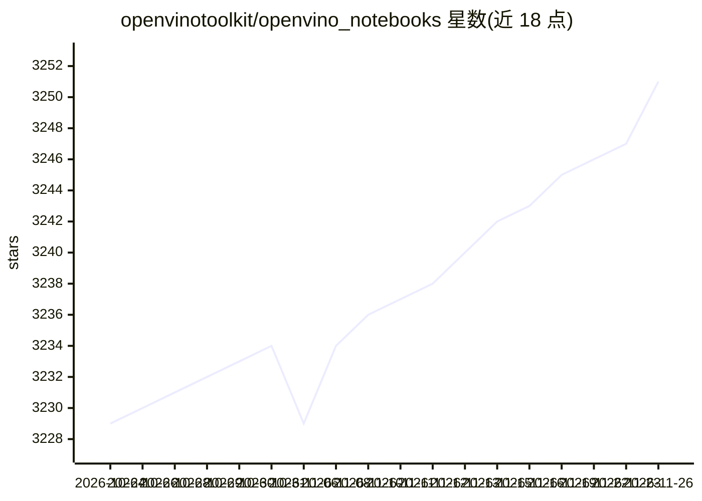

# openvinotoolkit/openvino_notebooks

⭐ 3,251 · Jupyter Notebook · Apache-2.0 · 推送 2026-11-25 · [GitHub](https://github.com/openvinotoolkit/openvino_notebooks) · [官网](https://openvinotoolkit.github.io/openvino_notebooks/) · 组织维护 · 中文 README

**OpenVINO 工具包的 Jupyter notebook 教程合集**

面向学习与实验 OpenVINO™ 工具包的即开即用 Jupyter notebook 集合：内容覆盖 OpenVINO 基础知识与如何使用其 API 进行优化的深度学习推理。提供 GitHub Pages 导航应用与索引文件浏览全部 notebook；支持 Windows/Ubuntu/macOS/Red Hat/CentOS/Azure ML/Docker/Amazon SageMaker 等多种环境的安装指南，也可经 Binder 或 Google Colab 免装在线运行。需 Python 与 Git；主分支随 OpenVINO 版本更新，旧版本需切换对应分支。

## 筛选速览

| 维度 | 判定 | 备注 |
|---|---|---|
| AI 角色 | `ai-knowledge` | 知识聚合/清单类 |
| 许可风险 | `permissive` | Apache-2.0 |
| 部署形态 | `desktop` | 安装包/桌面程序 |
| 模型依赖 | — | README 未给出锁定关系 |
| 硬件要求 | — | 无带数字的原话,不猜 |
| 安装摩擦 | `low` | 无编译、无系统依赖或容器化 |
| 成熟度 | — | 结构信号不足 |

## 能力要点

- 覆盖 OpenVINO 基础与优化深度学习推理 API 的 notebook 教程
- 支持本地、Docker、Azure ML、SageMaker 等多环境安装指南
- Binder 与 Google Colab 可免安装在线运行
- 提供 GitHub Pages 交互式导航与索引文件

## 适用场景

- 系统学习 OpenVINO 推理 API 的使用方法
- 在本地或云端实验深度学习推理优化
- 通过 notebook 模板搭建视觉类推理 demo

## 场景标签

`教程课程` · 领域:学习与行业

## 证据(README 行号)

> L9: A collection of ready-to-run Jupyter notebooks for learning and experimenting with the OpenVINO™ Toolkit. The notebo
> L26: |Windows|Ubuntu|macOS|Red Hat|CentOS|Azure ML|Docker|Amazon SageMaker|

## 星数曲线

2026-10-24 3,229 → 2026-11-26 3,251（+22）

---
*卡片 v1 · prompt 1.4 · 生成 2026-11-24 · 置信度 high · 依据 README sha `3336d87b6aea` · [字段定义](../../DATASET.md)*
