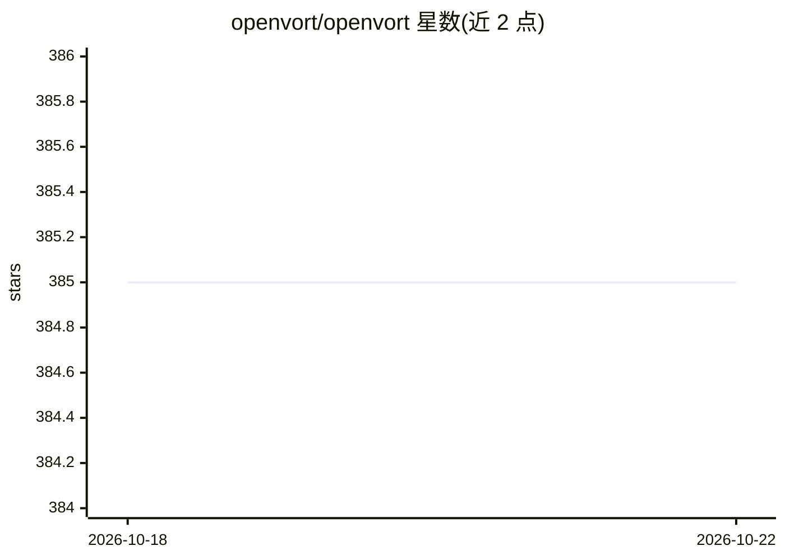

# openvort/openvort

⭐ 388 · Python · AGPL-3.0 · 推送 2026-10-21 · [GitHub](https://github.com/openvort/openvort) · [官网](https://openvort.com) · 组织维护 · 中文 README

**企业部署 AI 员工的开源平台，接入企微/钉钉/飞书协作**

开源 AI 员工平台（Python/FastAPI + Vue 3，AGPL-3.0）：创建绑定岗位与 Skill 的虚拟成员，通过 agentic loop 自主调用工具，执行日报、代码审查、CI/CD 等工作，并可一键创建 Docker 沙箱工作电脑。IM 侧支持企业微信、钉钉、飞书及 OpenClaw 多平台网关，Web 面板提供聊天、知识库（RAG）、定时任务等管理功能。LLM 需配置 API Key（Anthropic Claude / OpenAI 兼容协议），其他功能开箱即用。提供 Docker、pip、源码三种安装方式与 Skill/Plugin 扩展市场。

## 筛选速览

| 维度 | 判定 | 备注 |
|---|---|---|
| AI 角色 | `ai-native` | 本体是模型或模型工具 |
| 许可风险 | `viral` | AGPL-3.0 |
| 部署形态 | `self-host` | docker 或自建部署 |
| 模型依赖 | locked-api |  |
| 硬件要求 | — | 无带数字的原话,不猜 |
| 安装摩擦 | `low` | 无编译、无系统依赖或容器化 |
| 成熟度 | — | 结构信号不足 |

## 能力要点

- 基于 Claude tool use 的 agentic loop，支持多模型 Failover
- 企业微信/钉钉/飞书/OpenClaw 多 IM 通道，支持 ASR/TTS 语音消息
- 内置 10 个插件（VortFlow、VortGit、Jenkins CI/CD、RAG 知识库等），pip install 即可扩展
- 注册 Tool 通过 MCP Server 暴露，Cursor / Claude Desktop 可直接调用

## 适用场景

- 在团队 IM 里部署 AI 员工自动执行日报、代码审查、构建等任务
- 为 AI 员工一键创建 Docker 沙箱环境用于写代码跑脚本
- 通过扩展市场安装或发布 Skill 与插件扩展平台能力

## 场景标签

`聊天机器人` `RAG` `代码审查` `Agent 框架` · 领域:Agent 开发

## 证据(README 行号)

> L13: 开源 AI 员工平台 — 创建 AI 员工，让他们与真人一起在企业微信、钉钉、飞书里协作，就像多招了几个同事。
> L19: - **AI 驱动** — 基于 Claude tool use 的 agentic loop，Agent 自主决策调用工具，支持多模型 Failover
> L117: AI 功能需要在 **AI 配置** 页面设置 LLM API Key（支持 Anthropic Claude / OpenAI 兼容协议），其他功能开箱即用。

## 星数曲线

2026-10-18 385 → 2026-10-22 385（+0）

---
*卡片 v1 · prompt 1.4 · 生成 2026-10-21 · 置信度 mid · 依据 README sha `0105b017fca4` · [字段定义](../../DATASET.md)*
