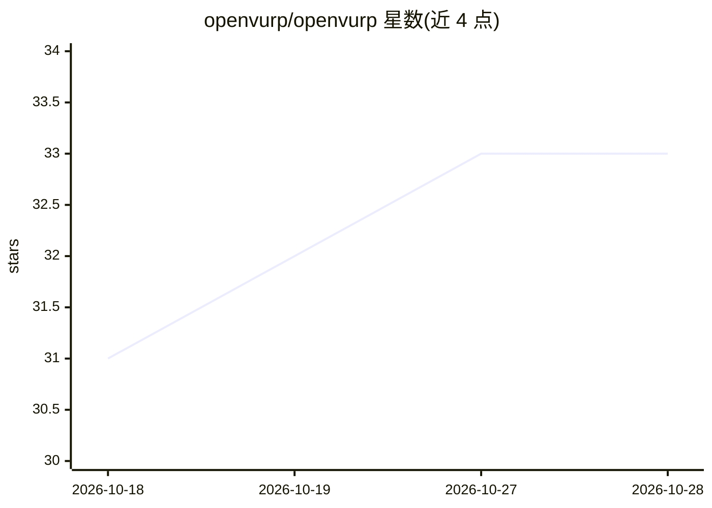

# openvurp/openvurp

⭐ 33 · Python · MIT · 推送 2026-09-04 · [GitHub](https://github.com/openvurp/openvurp) · 个人维护

**本地优先的多 AI agent 管家：自建 agent 各司其职并互相请教**

运行在用户自己电脑上的多 agent 框架：每个 agent 有名字、职责与引擎，可执行 shell 命令、读写文件、搜索网页、驱动浏览器；agent 互相知晓，可自行向合适的同事提问。对话与记忆以文件形式存于 memory/ 目录。引擎可选本地服务器（Ollama/llama.cpp/vLLM 等）、订阅 CLI 或 API（Anthropic/OpenAI/Groq），支持 PRIVACY_MODE 将私密对话限定本地模型。通过浏览器页面、Telegram、Discord、Slack、WhatsApp 访问，提供沙箱、审批、pacts 与审计等安全机制。

## 筛选速览

| 维度 | 判定 | 备注 |
|---|---|---|
| AI 角色 | `ai-ecosystem` | LLM/agent 周边工具 |
| 许可风险 | `permissive` | MIT |
| 部署形态 | `self-host` | docker 或自建部署 |
| 模型依赖 | local-ok | 支持本地模型 |
| 硬件要求 | — | 无带数字的原话,不猜 |
| 安装摩擦 | `low` | 无编译、无系统依赖或容器化 |
| 成熟度 | — | 结构信号不足 |

## 能力要点

- agent 间自动路由：每个 agent 携带同事名单，自行决定向谁请教
- 引擎与 agent 解耦：Ollama/LM Studio/llama.cpp/vLLM/Anthropic/OpenAI/Groq 均可选
- PRIVACY_MODE 将私密对话固定走本地模型，按模型名含 :cloud 判定
- 安全机制：沙箱、safe/auto/plan 审批模式、pacts 规则、全量审计日志

## 适用场景

- 在我的电脑上养一组分工明确的 agent（比价、盯账单、写代码）并让它们互相协作
- 用 Telegram/Discord 从手机访问同一批 agent 并远程审批敏感操作
- 把私密对话锁定本地模型、其余用云端模型的混合使用

## 场景标签

`Agent 框架` `多智能体` · 领域:Agent 开发

## 证据(README 行号)

> L12: You create them. Each one gets a name, a job, and an engine. They can run
> L125: - **Servers you run yourself** — Ollama, or anything speaking the OpenAI API

## 星数曲线

2026-10-18 31 → 2026-10-28 33（+2）

---
*卡片 v1 · prompt 1.4 · 生成 2026-10-25 · 置信度 high · 依据 README sha `d5c691457eed` · [字段定义](../../DATASET.md)*
