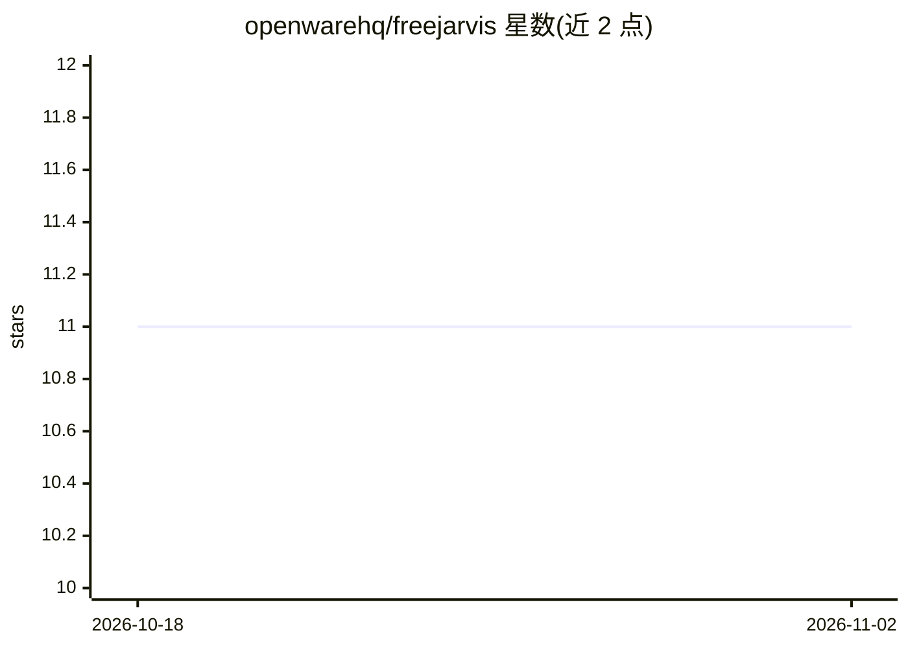

# openwarehq/freejarvis

⭐ 11 · TypeScript · NOASSERTION · 推送 2026-08-21 · [GitHub](https://github.com/openwarehq/freejarvis) · 组织维护

**自托管语音 agent 控制台：语音进出、工具、记忆与定时任务**

开源的本地优先语音助手前端（TypeScript/Next.js，Docker 部署）：按住空格键语音输入，浏览器语音识别与合成，逐句朗读回答并显示字幕行。可接入自托管 Hermes Agent 作为其界面（会话、cron、技能、工具集、审批面板），也可不接 agent 直接对接任意 OpenAI 兼容模型运行自带循环。内置八个工具（记忆存取、读网页、文件读写、cron 等），写文件与定时任务前暂停等待审批。限制：Chrome/Edge 的语音识别音频会发往 Google，无唤醒词，无登录与鉴权（仅绑定 localhost），调度器随 Web 进程存活，内存为子串搜索而非嵌入。

## 筛选速览

| 维度 | 判定 | 备注 |
|---|---|---|
| AI 角色 | `ai-native` | 本体是模型或模型工具 |
| 许可风险 | `none` | NOASSERTION |
| 部署形态 | `self-host` | docker 或自建部署 |
| 模型依赖 | local-ok | 支持本地模型 |
| 硬件要求 | — | 无带数字的原话,不猜 |
| 安装摩擦 | `low` | 无编译、无系统依赖或容器化 |
| 成熟度 | — | 结构信号不足 |

## 能力要点

- 双模式：接入自托管 Hermes Agent 或直连任意 OpenAI 兼容模型
- 语音双向交互：浏览器语音识别与本地 TTS，ElevenLabs 为可选付费增强
- 八内置工具+可选 shell，写文件/定时任务前展示参数等待审批
- cron 定时任务渲染为英文描述，路径经 symlink 解析后校验防逃逸

## 适用场景

- 在家用语音指挥自托管 agent 执行工具与定时任务
- 为已部署的 Hermes Agent 提供带语音和会话管理的操作界面
- 无账号无订阅地本地运行一个可发声的个人 AI 助手

## 场景标签

`语音 Agent` `AI 助手` · 领域:对话与助手

## 证据(README 行号)

> L11: The brain is yours: attach a self-hosted Hermes Agent
> L13: live. Attach nothing and it runs its own loop against any OpenAI-compatible model.
> L85: **Voice both ways, and hearing costs nothing ever.** Hold space, talk, let go. Recognition is

## 星数曲线

2026-10-18 11 → 2026-11-02 11（+0）

---
*卡片 v1 · prompt 1.4 · 生成 2026-11-01 · 置信度 high · 依据 README sha `4c651c47955d` · [字段定义](../../DATASET.md)*
