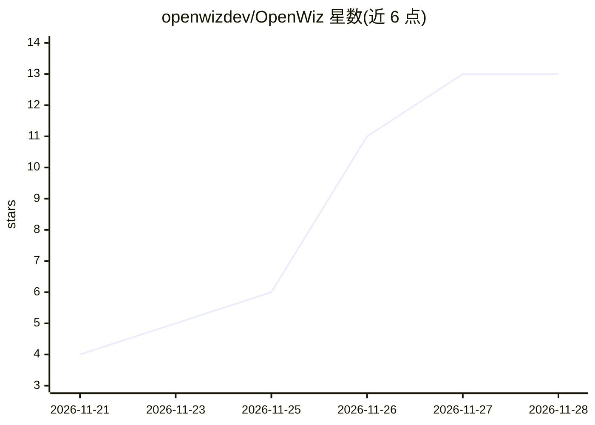

# openwizdev/OpenWiz

⭐ 13 · Python · Apache-2.0 · 推送 2026-11-27 · [GitHub](https://github.com/openwizdev/OpenWiz) · [官网](https://openwiz.dev) · 组织维护

**agent 工厂的开放内核：驱动代理编写、构建、审查并合并**

OpenWiz 自称 agent 工厂的开放内核，本仓库为内核本体，其他仓库在其上提供技能、循环与应用。内核由三部分组成：以 GitHub issues 存放规格、工单与状态记录，配记录校验工具；任意语言实现的驱动程序，响应 version/start/wake/stop 四条命令以接入自有主机；以及驱动测试套件。用户回答若干问题后由代理完成规格撰写、工单、构建、审查与合并。OpenWiz 不接触登录凭据，无自有服务器；0.1.0 尚未发布，当前仅有 Cloudroom 预发布版本。

## 筛选速览

| 维度 | 判定 | 备注 |
|---|---|---|
| AI 角色 | `ai-ecosystem` | LLM/agent 周边工具 |
| 许可风险 | `permissive` | Apache-2.0 |
| 部署形态 | `None` |  |
| 模型依赖 | — | README 未给出锁定关系 |
| 硬件要求 | — | 无带数字的原话,不猜 |
| 安装摩擦 | `low` | 无编译、无系统依赖或容器化 |
| 成熟度 | `idea` | |

## 能力要点

- 以 GitHub issues 作为规格/工单/状态的事实记录层，配校验工具
- 驱动协议仅四条命令（version/start/wake/stop），任意语言实现可接入自有主机
- 内核不接触登录凭据，无自有服务器，代理使用各自已登录的工具
- Rust 实现的 openwiz CLI

## 适用场景

- 在本地或 VPS 上运行由代理驱动的自动化开发流水线
- 通过记录校验与驱动测试套件核验工厂组件是否合规
- 接入自有主机运行编码代理

## 场景标签

`编码 Agent` `代码审查` · 领域:编码与开发

## 证据(README 行号)

> L3: **OpenWiz is the open kernel for agent factories. Bring your own everything. Owned by no one.** This repo is the ker
> L25: - **Records on GitHub.** Specs, tickets and one status note per agent live in your repo's issues. Anything that fol

## 星数曲线

2026-11-21 4 → 2026-11-28 13（+9）

---
*卡片 v1 · prompt 1.4 · 生成 2026-11-21 · 置信度 high · 依据 README sha `38715e3c23e2` · [字段定义](../../DATASET.md)*
