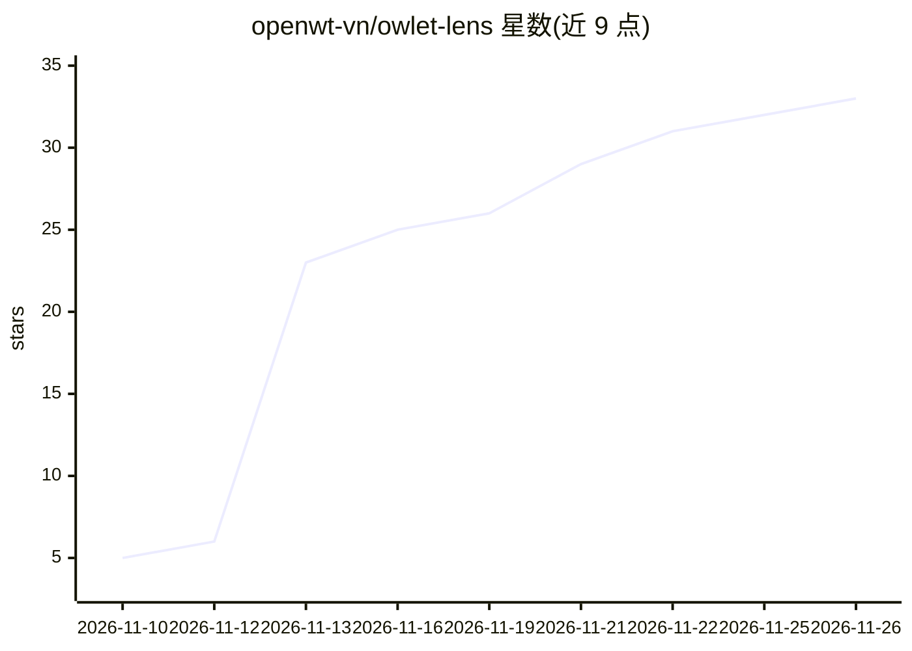

# openwt-vn/owlet-lens

⭐ 33 · JavaScript · Apache-2.0 · 推送 2026-11-18 · [GitHub](https://github.com/openwt-vn/owlet-lens) · 组织维护

**AI 代码评审工具：以评审线程互动并自动关闭已修复项**

面向使用 GitHub、GitLab、Bitbucket Cloud 或 Azure DevOps 的开发团队的 AI 代码评审工具。在拉取请求中以行内评审线程发布发现，读取开发者在线程中的回复并判定 fixed/won't fix/still open，修复后自动关闭线程，回归时重新打开。团队持续拒绝的发现可转为拟议的编码规范规则。运行于用户自己的 CI，支持 Anthropic、Gemini、DeepSeek、OpenRouter 或任意 OpenAI 兼容端点（含本地模型），无自有服务器。通过 npx 命令安装，提供 GitHub Action 与各平台流水线配置。

## 筛选速览

| 维度 | 判定 | 备注 |
|---|---|---|
| AI 角色 | `ai-native` | 本体是模型或模型工具 |
| 许可风险 | `permissive` | Apache-2.0 |
| 部署形态 | `library` | 以包/库形式分发 |
| 模型依赖 | locked-api |  |
| 硬件要求 | — | 无带数字的原话,不猜 |
| 安装摩擦 | `low` | 无编译、无系统依赖或容器化 |
| 成熟度 | — | 结构信号不足 |

## 能力要点

- 评审发现以行内线程发布，读取回复后自动关闭/重开线程
- 支持 GitHub、GitLab、Bitbucket Cloud、Azure DevOps 四平台
- 自带 LLM key（含本地模型），运行在用户 CI，无服务器无数据库
- 评审与回复可分别选用不同 provider 与模型，支持故障切换

## 适用场景

- 在 PR 流水线中自动获得 AI 代码评审并追踪修复状态
- 团队按自己的 LLM key 与本地模型做私有化代码评审
- 将团队反复拒绝的发现沉淀为编码规范规则

## 场景标签

`代码审查` · 领域:编码与开发

## 证据(README 行号)

> L3:  The AI code reviewer that reads your replies and closes its own threads.
> L21: Most AI reviewers post comments and walk away. Owlet Lens stays in the conversation: it posts findings as inline re
> L92: |Anthropic (default)|`anthropic-api-key`|Defaults: review `claude-opus-4-7`, reply `claude-haiku-4-5-20251001`|

## 星数曲线

2026-11-10 5 → 2026-11-26 33（+28）

---
*卡片 v1 · prompt 1.4 · 生成 2026-11-18 · 置信度 high · 依据 README sha `af45c58c8297` · [字段定义](../../DATASET.md)*
