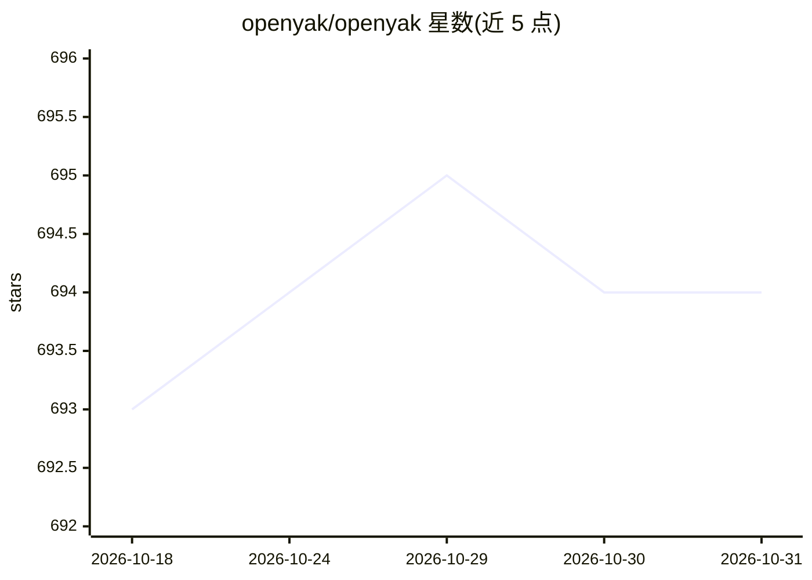

# openyak/openyak

⭐ 694 · TypeScript · Apache-2.0 · 推送 2026-09-05 · [GitHub](https://github.com/openyak/openyak) · [官网](https://open-yak.com/) · 组织维护 · 中文 README

**本地桌面 GUI：统一界面运行 Codex 与 Claude Code 等 AI agent**

基于 Electron 与 Rust+SQLite 的本地桌面应用，为 Codex 与 Claude Code 提供统一聊天工作台：对话与转录数据存于本地，可在任务内切换运行时并重放上下文；通过 Codex App Server 与 Claude Agent SDK 驱动原生运行时，ACP 为可选兼容路径。支持持久化文件标签页（Markdown/HTML/PDF/DOCX/代码高亮）、结构化审批与提问，以及基于 Playwright MCP 与独立 Chrome 会话的人机共享浏览器。需 Node 26 与 Rust 1.90 从源码构建运行，打包安装器与 Linux/Windows GUI 验证仍在进行中，当前为 v2 alpha。

## 筛选速览

| 维度 | 判定 | 备注 |
|---|---|---|
| AI 角色 | `ai-ecosystem` | LLM/agent 周边工具 |
| 许可风险 | `permissive` | Apache-2.0 |
| 部署形态 | `library` | 以包/库形式分发 |
| 模型依赖 | locked-api |  |
| 硬件要求 | — | 无带数字的原话,不猜 |
| 安装摩擦 | `low` | 无编译、无系统依赖或容器化 |
| 成熟度 | `idea` | |

## 能力要点

- Codex App Server 与 Claude Agent SDK 原生驱动，ACP 为可选兼容路径
- 对话数据本地存储，任务内可切换运行时并重放上下文
- Playwright MCP 共享浏览器：用户与 agent 操作同一页面
- 持久化文件标签页支持 Markdown/HTML/PDF/DOCX 与代码高亮

## 适用场景

- 用统一桌面界面同时使用 Codex 和 Claude Code，避免以终端为工作区
- 在会话旁直接打开 agent 产出的报告与代码文件
- 与 agent 共享浏览器页面，随时接管或交还控制权

## 场景标签

`编码 Agent` `浏览器自动化` · 领域:效率与自动化

## 证据(README 行号)

> L10: OpenYak is a local desktop GUI for Codex and Claude Code. Keep the conversation, inspect the files, and work alongs
> L21: - **Native runtimes by default.** Codex App Server and Claude Agent SDK drive the agents. ACP remains an explicit c
> L46: |Claude Code|Claude Agent SDK driving its CLI|Claude ACP adapter|

## 星数曲线

2026-10-18 693 → 2026-10-31 694（+1）

---
*卡片 v1 · prompt 1.4 · 生成 2026-10-21 · 置信度 high · 依据 README sha `b59897c8d8e7` · [字段定义](../../DATASET.md)*
