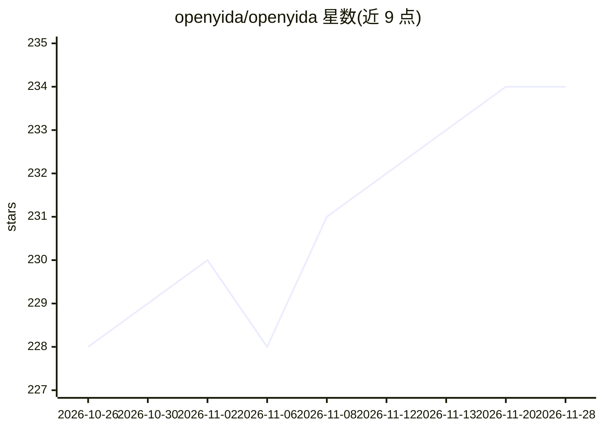

# openyida/openyida

⭐ 234 · JavaScript · MIT · 推送 2026-11-27 · [GitHub](https://github.com/openyida/openyida) · [官网](https://demo.aliwork.com/o/openyida/helpCenter) · 组织维护 · 中文 README

**面向开发者的宜搭 AI 助手 CLI：用对话构建宜搭应用**

OpenYida 是连接 AI 编码代理与阿里宜搭（Yida）平台的 CLI 工具，提供 openyida/yida 两个命令，供 agent 创建应用、表单、流程、自定义页面、报表与集成，并检查 schema、生成源码、编译发布页面、诊断问题。产物仍是原生宜搭应用，可在宜搭内继续编辑并沿用企业安全控制。需 Node.js ≥18，npm 全局安装，登录采用钉钉 OAuth，支持 Codex、Claude Code、Cursor、QwenWork 等多种编码工具。

## 筛选速览

| 维度 | 判定 | 备注 |
|---|---|---|
| AI 角色 | `ai-ecosystem` | LLM/agent 周边工具 |
| 许可风险 | `permissive` | MIT |
| 部署形态 | `library` | 以包/库形式分发 |
| 模型依赖 | — | README 未给出锁定关系 |
| 硬件要求 | — | 无带数字的原话,不猜 |
| 安装摩擦 | `low` | 无编译、无系统依赖或容器化 |
| 成熟度 | `idea` | |

## 能力要点

- 为 AI 编码代理提供稳定的 openyida CLI 命令接口
- 覆盖应用/表单/流程/自定义页面/数据/集成/运维七类能力
- 支持 Codex、Claude Code、Cursor、QwenWork、Qoder 等 9 种工具
- OAuth 登录、auth profile 切换与环境自检命令

## 适用场景

- 让编码代理在宜搭上创建 CRM、审批流等业务应用
- 用对话方式改造已有宜搭应用的外观与页面
- 批量管理宜搭表单字段、权限与流程配置

## 场景标签

`编码 Agent` `AI 助手` · 领域:编码与开发

## 证据(README 行号)

> L5: **AI-native CLI for building applications with AI Yida.**
> L21: OpenYida is a bridge between AI coding tools and Yida. It gives agents a stable `openyida` CLI to create resources,
> L164: ## Supported AI Coding Tools

## 星数曲线

2026-10-26 228 → 2026-11-28 234（+6）

---
*卡片 v1 · prompt 1.4 · 生成 2026-11-28 · 置信度 high · 依据 README sha `c1e8dca9e1e2` · [字段定义](../../DATASET.md)*
