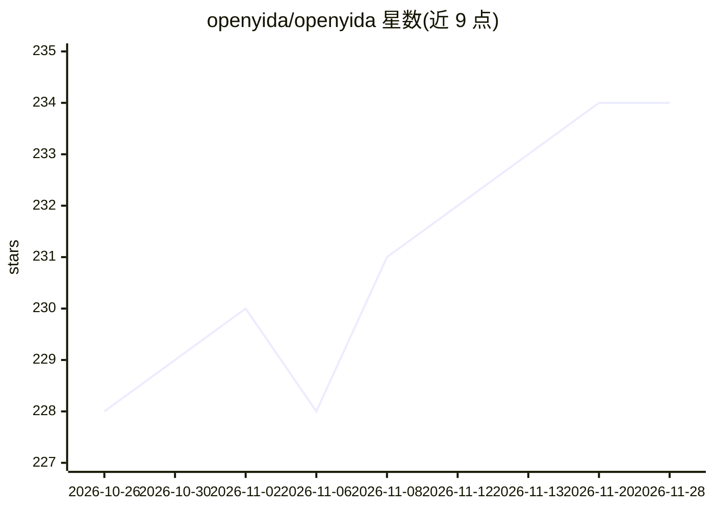

# openyida/openyida

⭐ 234 · JavaScript · MIT · 推送 2026-11-27 · [GitHub](https://github.com/openyida/openyida) · [官网](https://demo.aliwork.com/o/openyida/helpCenter) · 组织维护 · 中文 README

**连接 AI 编码代理与宜搭平台的低代码应用开发 CLI**

OpenYida 是一个 npm 分发的 CLI 工具，为 AI 编码代理提供稳定命令集：创建应用与表单、生成 React 自定义页面、配置审批流、查询数据、管理 HTTP 连接器、诊断环境并发布页面。产物是原生宜搭应用，可在宜搭平台继续编辑并复用企业安全控制。支持 Fast/Plan 两种构建模式，Plan 模式先产出可评审提案。要求 Node.js ≥18，登录走钉钉 OAuth，支持 Codex、Claude Code、Cursor、QwenWork、Qoder 等 9 个编码工具。

## 筛选速览

| 维度 | 判定 | 备注 |
|---|---|---|
| AI 角色 | `ai-ecosystem` | LLM/agent 周边工具 |
| 许可风险 | `permissive` | MIT |
| 部署形态 | `library` | 以包/库形式分发 |
| 模型依赖 | — | README 未给出锁定关系 |
| 硬件要求 | — | 无带数字的原话,不猜 |
| 安装摩擦 | `low` | 无编译、无系统依赖或容器化 |
| 成熟度 | — | 结构信号不足 |

## 能力要点

- 为 AI 代理提供 openyida/yida 命令行，覆盖应用、表单、页面、流程全流程
- 支持 19 种业务字段类型的原生表单创建与 .canvas.jsx 自定义页面编译发布
- 钉钉 OAuth 登录与多认证 profile 管理，支持 DingTalk/QwenWork 组织
- Codex 环境下安装后注入 @宜搭 上下文插件

## 适用场景

- 用对话方式在宜搭上生成 CRM 等业务应用
- 为现有宜搭应用生成自定义页面并发布
- 通过 CLI 管理宜搭审批流与连接器集成

## 场景标签

`代码生成` · 领域:编码与开发

## 证据(README 行号)

> L5: **AI-native CLI for building applications with AI Yida.**
> L21: OpenYida is a bridge between AI coding tools and Yida. It gives agents a stable `openyida` CLI to create resources,
> L164: ## Supported AI Coding Tools

## 星数曲线

2026-10-26 228 → 2026-11-28 234（+6）

---
*卡片 v1 · prompt 1.4 · 生成 2026-11-26 · 置信度 high · 依据 README sha `c98091e15c01` · [字段定义](../../DATASET.md)*
