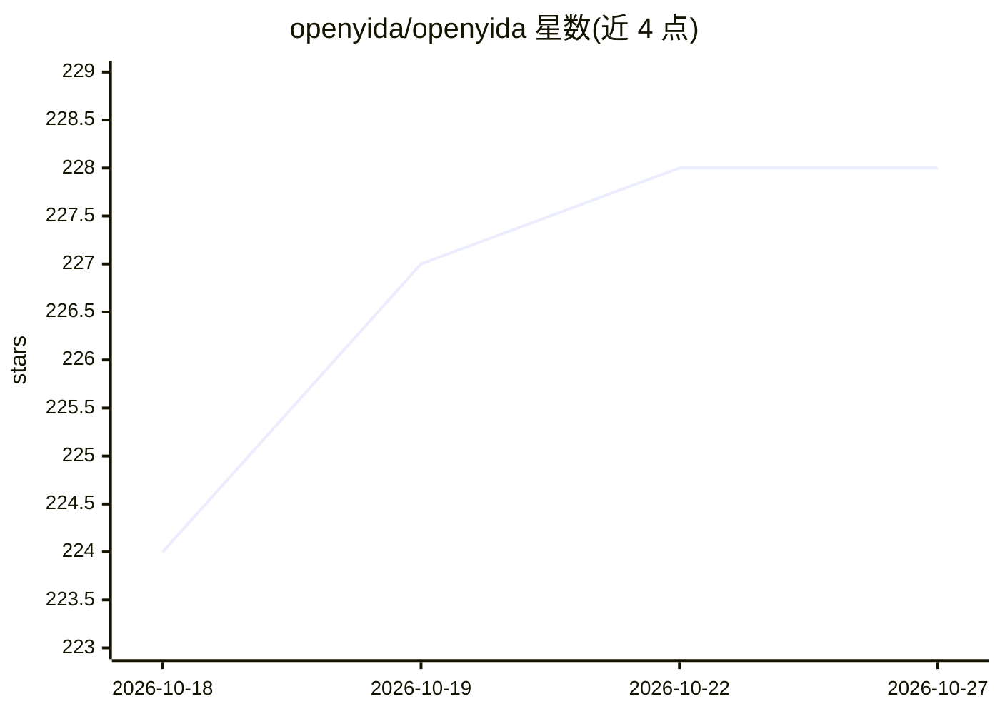

# openyida/openyida

⭐ 228 · JavaScript · MIT · 推送 2026-10-26 · [GitHub](https://github.com/openyida/openyida) · [官网](https://demo.aliwork.com/o/openyida/helpCenter) · 组织维护 · 中文 README

**让 AI 编码代理通过 CLI 构建钉钉宜搭低代码应用的工具**

OpenYida 是连接 AI 编码代理与钉钉宜搭低代码平台的 CLI：提供 openyida/yida 命令，让 Codex、Claude Code、Cursor 等代理创建应用、表单、流程、自定义页面、集成与部署配置。支持 OAuth 登录、主题定制、React 页面生成编译发布、流程编排与数据查询，产物仍是原生宜搭应用可继续在平台编辑。需 Node.js 18+，npm 全局安装；部分功能（A2UI/消息）需另行安装可选的 DingTalk Workspace CLI。

## 筛选速览

| 维度 | 判定 | 备注 |
|---|---|---|
| AI 角色 | `ai-ecosystem` | LLM/agent 周边工具 |
| 许可风险 | `permissive` | MIT |
| 部署形态 | `library` | 以包/库形式分发 |
| 模型依赖 | — | README 未给出锁定关系 |
| 硬件要求 | — | 无带数字的原话,不猜 |
| 安装摩擦 | `low` | 无编译、无系统依赖或容器化 |
| 成熟度 | — | 结构信号不足 |

## 能力要点

- 提供稳定 CLI 供代理创建宜搭应用/表单/流程/页面
- 支持 Codex、Claude Code、Cursor、Qoder 等 9 种 AI 编码工具
- OAuth 登录、多 auth profile 与环境诊断
- 自定义页面基于 React（.canvas.jsx）生成、编译与发布

## 适用场景

- 用对话驱动 AI 代理搭建宜搭 CRM/审批等业务应用
- 对既有宜搭应用做改版与备份
- 通过 CLI 查询表单/流程数据并做异常检查

## 场景标签

 · 领域:低代码平台/AI 编码工具

## 证据(README 行号)

> L5: **AI-native CLI for building DingTalk Yida low-code applications.**
> L21: OpenYida is a bridge between AI coding tools and Yida. It gives agents a stable `openyida` CLI to create resources,

## 星数曲线

2026-10-18 224 → 2026-10-27 228（+4）

---
*卡片 v1 · prompt 1.4 · 生成 2026-10-22 · 置信度 high · 依据 README sha `914f5835023e` · [字段定义](../../DATASET.md)*
