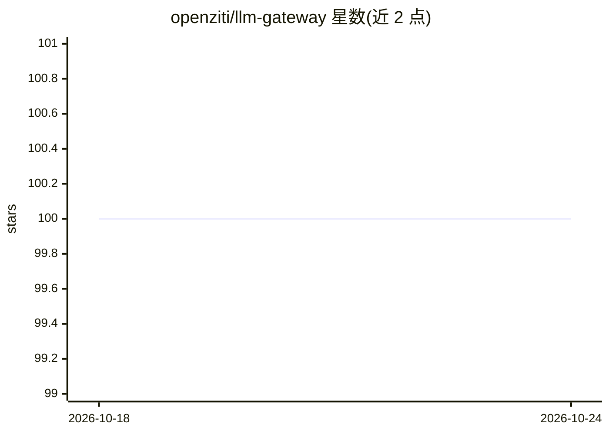

# openziti/llm-gateway

⭐ 100 · Go · Apache-2.0 · 推送 2026-10-14 · [GitHub](https://github.com/openziti/llm-gateway) · 组织维护

**零信任 LLM 网关：OpenAI 兼容代理，跨多后端语义路由与负载均衡**

单一 Go 二进制加一份 YAML 配置运行的 OpenAI 兼容 API 代理：按模型名前缀将请求路由到 OpenAI、Anthropic 或任意 OpenAI 兼容后端（Ollama、vLLM、llama-server、SGLang 等），并透明转换 Anthropic Messages API 格式、支持 SSE 流式。提供三层级联语义路由（启发式关键词、embedding 相似度、LLM 分类器），在客户端省略 model 字段时自动选模型；支持多端点加权轮询、健康检查与被动故障转移。可选通过 zrok/OpenZiti 实现零信任网络暴露，无需开放端口。虚拟 API key 用于客户端认证并可按 glob 模式限制模型。Prometheus/OpenTelemetry 指标与请求追踪日志内置。

## 筛选速览

| 维度 | 判定 | 备注 |
|---|---|---|
| AI 角色 | `ai-ecosystem` | LLM/agent 周边工具 |
| 许可风险 | `permissive` | Apache-2.0 |
| 部署形态 | `desktop` | 安装包/桌面程序 |
| 模型依赖 | local-ok | 支持本地模型 |
| 硬件要求 | — | 无带数字的原话,不猜 |
| 安装摩擦 | `low` | 无编译、无系统依赖或容器化 |
| 成熟度 | — | 结构信号不足 |

## 能力要点

- 三层级联语义路由（启发式/embedding/LLM 分类器），model 字段可省略
- 多端点加权轮询负载均衡、健康检查与被动故障转移
- 通过 zrok/OpenZiti 零信任暴露网关与连接后端，无需防火墙规则
- 虚拟 API key 认证，可按 glob 模式限制可访问模型

## 适用场景

- 用统一 OpenAI 兼容入口聚合 OpenAI、Anthropic 与本地推理后端
- 在 NAT/隔离网络中零信任暴露 LLM 网关并连接 GPU 推理机
- 按请求内容自动选择合适模型，免去手工维护路由表

## 场景标签

`模型网关` · 领域:Agent 开发

## 证据(README 行号)

> L3: An OpenAI-compatible API proxy that routes requests to OpenAI, Anthropic, and any OpenAI-compatible backend (Ollama,
> L11: - **Multi-endpoint load balancing** — weighted round-robin, health checks with passive failover, and VM sleep detec
> L12: - **Single binary, zero infrastructure** — one Go binary, one YAML file. No database, no message queue, no sidecar.

## 星数曲线

2026-10-18 100 → 2026-10-24 100（+0）

---
*卡片 v1 · prompt 1.4 · 生成 2026-10-23 · 置信度 high · 依据 README sha `3f79068dd093` · [字段定义](../../DATASET.md)*
