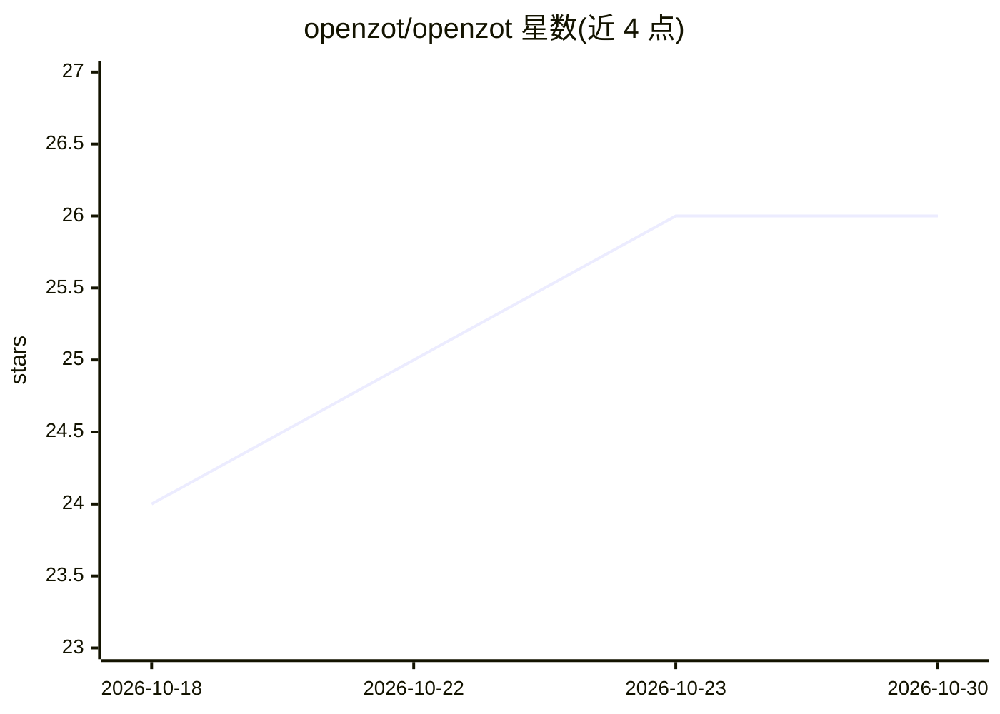

# openzot/openzot

⭐ 26 · Go · MIT · 推送 2026-10-14 · [GitHub](https://github.com/openzot/openzot) · [官网](https://zot.im) · 组织维护

**单文件自动软件工厂：按工单自动编码构建测试直到验收**

约 11 MiB 的单一二进制编码 agent：接收包含目标、验收标准与约束的 YAML 工单，自动完成规划、编辑、构建、测试与修复直至工单结束，无聊天循环与逐次审批，无托管引擎与遥测。通过用户自己的 key 连接任意 OpenAI 兼容提供商（默认 zai/glm-5.2，支持 anthropic、本地 ollama、网关、自定义端点）。提供压缩循环检测、可恢复日志与无人值守运行能力；注意 --dir 不是沙箱，且项目处于 0.x 阶段，行为可能变更。

## 筛选速览

| 维度 | 判定 | 备注 |
|---|---|---|
| AI 角色 | `ai-native` | 本体是模型或模型工具 |
| 许可风险 | `permissive` | MIT |
| 部署形态 | `desktop` | 安装包/桌面程序 |
| 模型依赖 | local-ok | 支持本地模型 |
| 硬件要求 | — | 无带数字的原话,不猜 |
| 安装摩擦 | `low` | 无编译、无系统依赖或容器化 |
| 成熟度 | `idea` | |

## 能力要点

- 单二进制（约 11 MiB）运行，无托管引擎与遥测
- 工单（YAML）驱动：队列、批量、流式执行直至验收
- 支持任意 OpenAI 兼容提供商，含本地 ollama 与自定义端点
- 内建压缩、循环检测与可恢复日志，面向无人值守运行

## 适用场景

- 开发者提交工单让 agent 无人值守地完成编码与测试
- 用本地或自有 API key 运行编码 agent，数据不出本机
- 以 watch 模式把目录作为任务投递箱持续处理工单

## 场景标签

`编码 Agent` · 领域:编码与开发

## 证据(README 行号)

> L9: zot is an automated software factory in a single ~11 MiB binary. It takes a
> L11: constraints to hold - and plans, edits, builds, tests and fixes until the work
> L32: zot defaults to the `zai` provider running `glm-5.2`. Export a key, write an
> L43: `--provider anthropic`, a local `--provider ollama`, a gateway, a custom

## 星数曲线

2026-10-18 24 → 2026-10-30 26（+2）

---
*卡片 v1 · prompt 1.4 · 生成 2026-10-26 · 置信度 high · 依据 README sha `ccc3291a86dd` · [字段定义](../../DATASET.md)*
