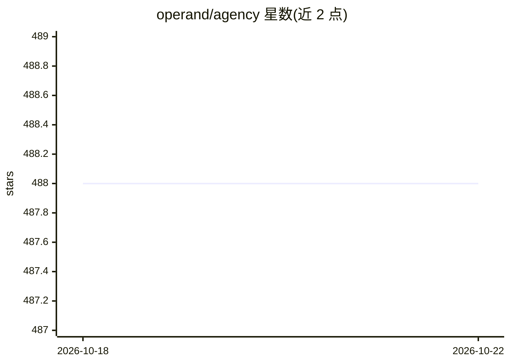

# operand/agency

⭐ 488 · Python · MIT · 推送 2026-06-10 · [GitHub](https://github.com/operand/agency) · [官网](https://createwith.agency) · 组织维护

**Python Actor 模型框架：构建 agent 集成系统**

Agency 是一个 Python 库，提供基于 Actor 模型的框架，用于创建 agent 集成系统。所有实体（AI agent、软件接口、人类用户）均表示为 Agent 类实例，通过 action 暴露可被其他 agent 在运行时发现与调用的方法，支持访问策略、生命周期回调与日志。提供 LocalSpace（同应用内）与 AMQPSpace（跨网络、RabbitMQ）两种连接实现，支持多进程/多线程并发。示例含 OpenAI 与 HuggingFace agent 及 Gradio UI、Docker 配置。

## 筛选速览

| 维度 | 判定 | 备注 |
|---|---|---|
| AI 角色 | `ai-ecosystem` | LLM/agent 周边工具 |
| 许可风险 | `permissive` | MIT |
| 部署形态 | `library` | 以包/库形式分发 |
| 模型依赖 | — | README 未给出锁定关系 |
| 硬件要求 | — | 无带数字的原话,不猜 |
| 安装摩擦 | `low` | 无编译、无系统依赖或容器化 |
| 成熟度 | — | 结构信号不足 |

## 能力要点

- 基于 Actor 模型的 Agent 类与 action 定义
- LocalSpace / AMQPSpace 两种连接实现
- 访问策略、生命周期回调与详细日志
- 多进程/多线程并发与 AMQP 网络化支持

## 适用场景

- 构建自定义多 agent 系统
- 将 agent 与传统软件系统连接通信
- 实验 agent 架构并参考示例应用

## 场景标签

`多智能体` `Agent 框架` · 领域:Agent 开发

## 证据(README 行号)

> L3: Agency is a python library that provides an [Actor
> L11: Agency's goal is to enable developers to create custom agent-based applications

## 星数曲线

2026-10-18 488 → 2026-10-22 488（+0）

---
*卡片 v1 · prompt 1.4 · 生成 2026-10-21 · 置信度 high · 依据 README sha `a2ab31912cb2` · [字段定义](../../DATASET.md)*
