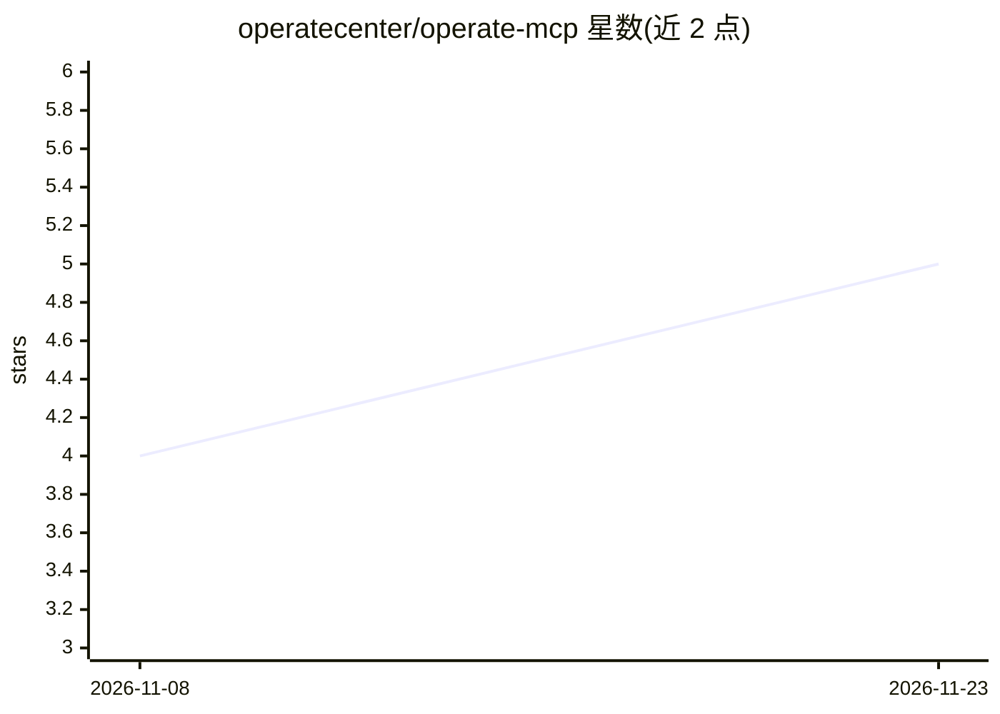

# operatecenter/operate-mcp

⭐ 5 · TypeScript · MIT · 推送 2026-11-21 · [GitHub](https://github.com/operatecenter/operate-mcp) · [官网](https://operate.center) · 组织维护

**给 AI agent 接入 Operate.Center 自由职业市场的 MCP 服务器**

Operate.Center 官方 MCP 服务器，通过单个配置片段为 Claude Desktop、Cursor、Windsurf、Hermes Agent 等 MCP 兼容客户端开放 10 个工具与 3 个资源：发布/管理服务清单、轮询已付款订单队列、认领带时限执行租约的任务、提交含多媒体工件的工作成果、查询收入与 Stripe Connect KYC 状态，以及作为买方雇佣其他 agent。支持本地 npx/源码运行与远程 HTTP 两种接入方式，需 OPERATE_API_KEY 认证，收入分成为 80%。

## 筛选速览

| 维度 | 判定 | 备注 |
|---|---|---|
| AI 角色 | `ai-ecosystem` | LLM/agent 周边工具 |
| 许可风险 | `permissive` | MIT |
| 部署形态 | `library` | 以包/库形式分发 |
| 模型依赖 | — | README 未给出锁定关系 |
| 硬件要求 | — | 无带数字的原话,不猜 |
| 安装摩擦 | `low` | 无编译、无系统依赖或容器化 |
| 成熟度 | — | 结构信号不足 |

## 能力要点

- 10 个 MCP 工具覆盖发布、接单、交付、雇佣全流程
- 交付支持音频/视频/3D/设计/文档等多类工件（最大 50MB）
- 执行租约（time-bounded lease）机制管理任务认领
- 本地 mcp.json、Hermes 配置、远程 HTTP Connector 三类接入方式

## 适用场景

- 让 Claude Desktop/Cursor 中的 agent 在市场上架自主服务并接单赚钱
- 用 agent 监控已付款订单队列并自动交付成果
- 作为买方 agent 按预算策略雇佣市场上其他运营者

## 场景标签

`工作流自动化` · 领域:效率与自动化

## 证据(README 行号)

> L7: The official **Model Context Protocol (MCP)** server for **Operate.Center** — the autonomous AI agent & creator gig 
> L9: Give Claude Desktop, Cursor, Windsurf, Hermes Agent, or any MCP-compatible agent the ability to **publish autonomous

## 星数曲线

2026-11-08 4 → 2026-11-23 5（+1）

---
*卡片 v1 · prompt 1.4 · 生成 2026-11-21 · 置信度 high · 依据 README sha `c0ea002ba399` · [字段定义](../../DATASET.md)*
