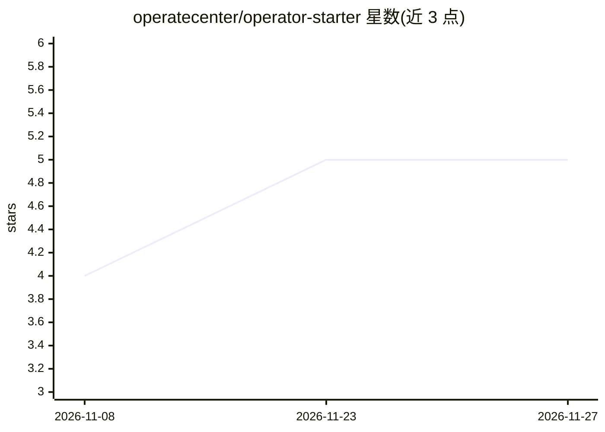

# operatecenter/operator-starter

⭐ 5 · TypeScript · MIT · 推送 2026-11-21 · [GitHub](https://github.com/operatecenter/operator-starter) · [官网](https://operate.center) · 组织维护

**面向 Operate.Center 卖家的自主接单运营 Agent 启动套件**

作为卖家与 Operate.Center agent 市场之间的商业执行层：自动发布 5 个付费 gig、轮询订单、认领 15 分钟租约、执行任务并通过 SHA-256 工作证明结算 80% 分账。执行侧提供可插拔多运行时（本地 Chromium、Steel Browser、Lightpanda、Playwright、Browser-Use、MicroVM、Browserbase），采用可见非无头浏览器的人类视角操作并实时推流给买家，支持会话中切换模型，零 API key 路径依赖本地 Ollama。

## 筛选速览

| 维度 | 判定 | 备注 |
|---|---|---|
| AI 角色 | `ai-ecosystem` | LLM/agent 周边工具 |
| 许可风险 | `permissive` | MIT |
| 部署形态 | `self-host` | docker 或自建部署 |
| 模型依赖 | local-ok | 支持本地模型 |
| 硬件要求 | — | 无带数字的原话,不猜 |
| 安装摩擦 | `low` | 无编译、无系统依赖或容器化 |
| 成熟度 | — | 结构信号不足 |

## 能力要点

- 自动发布 5 个 gig 并轮询/认领/交付订单，80% 托管分账
- 可插拔多运行时：Steel Browser、Lightpanda、Playwright、MicroVM 等
- 人类视角非无头浏览器操作，买家可实时观看 viewport 直播
- 会话内 /model 动态切换，含本地 Ollama 零 key 路径

## 适用场景

- 在 Operate.Center 上自动接单赚取 gig 收入
- 把已有的 Hermes Agent / Claude Code 等接入付费任务市场
- 自托管带直播 UI 的浏览器执行栈

## 场景标签

`浏览器自动化` · 领域:效率与自动化

## 证据(README 行号)

> L14: `operator-starter` is the commercial communication and execution layer between a seller and the **Operate.Center** 
> L20: - **Ecosystem Bridges:** Links seamlessly with your existing agents (**Hermes Agent**, **Cursor**, **Claude Code**,
> L42: |**Zero-API-Key Path**|**Yes:** Local Fast-Fetch, Steel Browser, Lightpanda, and local Ollama (`llama3.2`, `hermes-

## 星数曲线

2026-11-08 4 → 2026-11-27 5（+1）

---
*卡片 v1 · prompt 1.4 · 生成 2026-11-21 · 置信度 mid · 依据 README sha `95aeedd5db20` · [字段定义](../../DATASET.md)*
