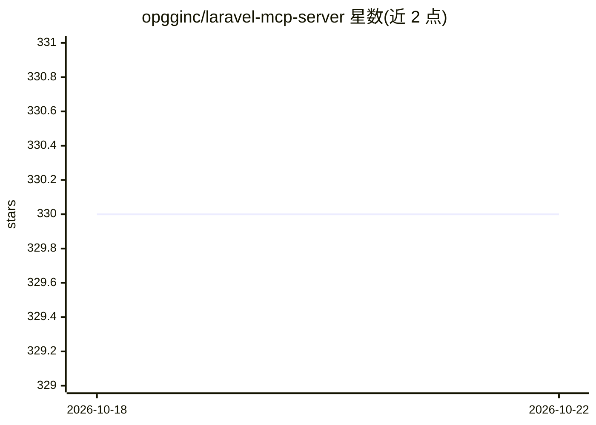

# opgginc/laravel-mcp-server

⭐ 330 · PHP · MIT · 推送 2026-04-26 · [GitHub](https://github.com/opgginc/laravel-mcp-server) · [官网](https://op.gg/open-source/laravel-mcp-server) · 组织维护

**Laravel/Lumen 的 MCP 服务器构建包，面向 PHP 开发者**

OP.GG 维护的 Laravel/Lumen Composer 包，以路由优先方式注册 MCP 端点（Route::mcp / McpRoute::register），通过 Streamable HTTP 传输暴露 tool、resource、resource template 与 prompt。支持按查询字符串动态过滤工具集、Laravel 风格 JsonSchema 构建器、从 OpenAPI 规格生成 MCP 工具及反向导出 OpenAPI 文档。2.0.0 版本起仅支持 Streamable HTTP 传输，移除旧版工具传输方法，需 PHP>=8.2 与 Laravel/Lumen>=9.x。生产安全依赖用户自行挂 Laravel 中间件。

## 筛选速览

| 维度 | 判定 | 备注 |
|---|---|---|
| AI 角色 | `ai-ecosystem` | LLM/agent 周边工具 |
| 许可风险 | `permissive` | MIT |
| 部署形态 | `library` | 以包/库形式分发 |
| 模型依赖 | — | README 未给出锁定关系 |
| 硬件要求 | — | 无带数字的原话,不猜 |
| 安装摩擦 | `low` | 无编译、无系统依赖或容器化 |
| 成熟度 | — | 结构信号不足 |

## 能力要点

- Route::mcp() 路由优先注册 MCP 端点，支持 tool/resource/prompt/通知
- 从 OpenAPI 规格生成 MCP 工具，并可将 MCP 工具导出为 OpenAPI 文档
- 按查询字符串的动态工具过滤（同一过滤集作用于 tools/list 与 tools/call）
- artisan 生成器：make:mcp-tool、make:mcp-resource、make:swagger-mcp-tool 等

## 适用场景

- 在 Laravel 应用中暴露 MCP 工具供 AI 客户端调用
- 把现有 OpenAPI/Swagger 接口转为 MCP 工具
- 按请求参数在同一端点暴露不同工具子集

## 场景标签

 · 领域:Web 开发/LLM 基础设施

## 证据(README 行号)

> L34: Laravel MCP Server provides route-based MCP endpoint registration for Laravel and Lumen.
> L37: - Streamable HTTP transport

## 星数曲线

2026-10-18 330 → 2026-10-22 330（+0）

---
*卡片 v1 · prompt 1.4 · 生成 2026-10-21 · 置信度 mid · 依据 README sha `46f7f30136cd` · [字段定义](../../DATASET.md)*
