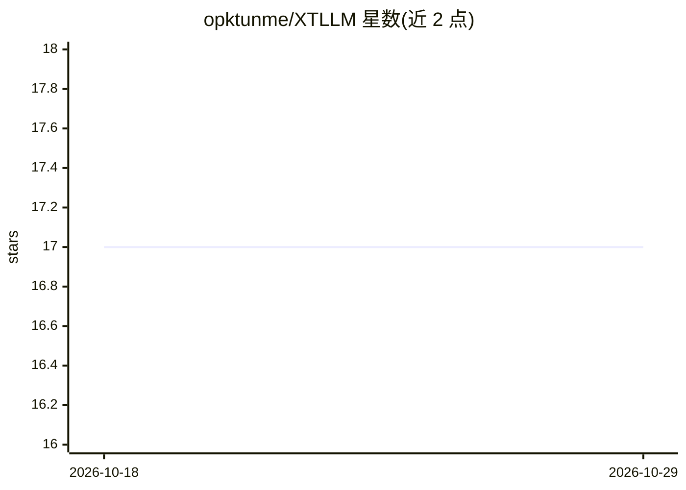

# opktunme/XTLLM

⭐ 17 · C++ · NOASSERTION · 推送 2026-09-22 · [GitHub](https://github.com/opktunme/XTLLM) · 个人维护

**Windows 上用 Vulkan 在消费级 AMD GPU 跑超大 MoE 模型的推理引擎**

C++ 编写的实验性纯文本 Vulkan 推理引擎，面向在消费级 AMD 显卡上运行超大规模 MoE 模型：VRAM 存放模型专用工作集，系统 RAM 存放限额专家层，冷数据留在 NVMe，长上下文 K/V 状态放在显式核算的主机内存。支持 Qwen3.5/3.6/3.8、DeepSeek V4、Nemotron 3 Nano 等后端，模型权重不随附分发。仅 RDNA2 RX 6700 XT 12GB 经硬件验证，RDNA3/4 为预期兼容；Windows 10 22H2/11、Vulkan 1.3 驱动、Python 3.11+、NVMe 盘为前置条件，Linux 与非 AMD 设备未验证。发行 ZIP 含原生引擎与转换器，无需自行编译。

## 筛选速览

| 维度 | 判定 | 备注 |
|---|---|---|
| AI 角色 | `ai-ecosystem` | LLM/agent 周边工具 |
| 许可风险 | `none` | NOASSERTION |
| 部署形态 | `desktop` | 安装包/桌面程序 |
| 模型依赖 | — | README 未给出锁定关系 |
| 硬件要求 | — | 无带数字的原话,不猜 |
| 安装摩擦 | `medium` | 含编译或系统依赖之一 |
| 成熟度 | `idea` | |

## 能力要点

- VRAM/RAM/NVMe 三级显存层级设计运行大于显存的 MoE 模型
- 7 个模型后端，最大至 284B 参数（~13B 激活）
- 有界长上下文执行，最高至 ~1M 上下文
- 发行 ZIP 含原生引擎与转换器，无需 CMake/编译器/Vulkan SDK

## 适用场景

- 在 12GB AMD 显卡上本地运行百亿至千亿参数 MoE 模型
- 大系统内存 + NVMe 场景下做长上下文解码
- RDNA2/3/4 显卡的 Windows 本地推理（仅 RDNA2 已验证）

## 场景标签

`推理引擎` · 领域:训练与推理

## 证据(README 行号)

> L26: XTLLM (eXpert-Tier LLM) is an experimental, text-only Vulkan inference engine for
> L39: > **Status:** Windows/RDNA2 research preview. Greedy text generation is working.

## 星数曲线

2026-10-18 17 → 2026-10-29 17（+0）

---
*卡片 v1 · prompt 1.4 · 生成 2026-10-29 · 置信度 high · 依据 README sha `643a6fa39d1c` · [字段定义](../../DATASET.md)*
