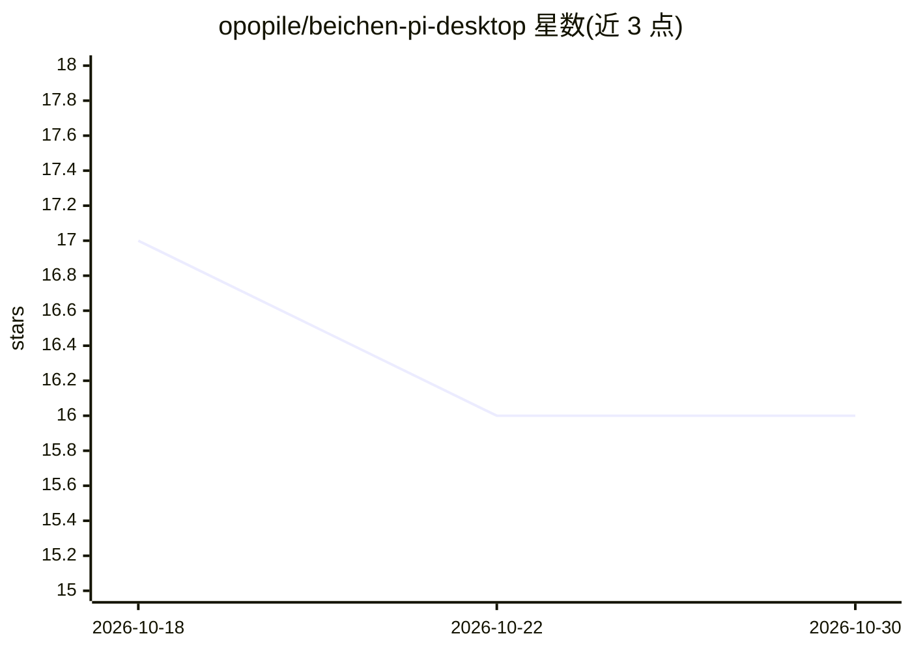

# opopile/beichen-pi-desktop

⭐ 16 · TypeScript · MIT · 推送 2026-09-05 · [GitHub](https://github.com/opopile/beichen-pi-desktop) · 个人维护 · 中文 README

**面向本地模型的 Windows 桌面 Agent 平台，含上下文治理与 Token 仪表**

基于 Electron 与 Pi 生态的 Windows 桌面 Agent 应用：原生接入 Ollama、LM Studio、vLLM 及 OpenAI-compatible 本地端点，另支持 OpenAI Responses、Anthropic Messages、Google Generative AI。核心机制为回合后思考上下文治理（Quantum Collapse 摘要已完成 thinking、Ghost Payload 从后续请求剔除）、五种 Agent 模式、集中式 Token/上下文仪表（用量、缓存、费用、token/s）。应用本身不下载或量化模型，仅 Windows 10/11 x64 提供，安装包内置 Node 24 运行时。

## 筛选速览

| 维度 | 判定 | 备注 |
|---|---|---|
| AI 角色 | `ai-native` | 本体是模型或模型工具 |
| 许可风险 | `permissive` | MIT |
| 部署形态 | `desktop` | 安装包/桌面程序 |
| 模型依赖 | local-ok | 支持本地模型 |
| 硬件要求 | — | 无带数字的原话,不猜 |
| 安装摩擦 | `low` | 无编译、无系统依赖或容器化 |
| 成熟度 | — | 结构信号不足 |

## 能力要点

- Quantum Collapse / Ghost Payload 回合后 thinking 摘要与剔除，不削弱当前回合推理
- 完整 Token 可观测性仪表：上下文占用、缓存读写、命中率、费用、token/s
- 五档 Agent 模式（CODEX/BENCHMARK/ULTRA MAX/QUANTUM/GHOST）
- 每窗口独立 Pi RPC、会话、模型与推理强度，支持多开

## 适用场景

- 在 Windows 上用本地 Ollama/LM Studio/vLLM 模型执行代码编辑与长任务
- 监控长会话中的上下文余量与 Token 消耗明细
- 无人值守跑复杂任务并在结束后只取最终结果

## 场景标签

`编码 Agent` · 领域:编码与开发

## 证据(README 行号)

> L27: 北辰 Pi 把 Pi 的模型、会话、工具、技能、扩展、认证与原生自动压缩装进一个 Windows 桌面 Agent：界面尽量少，控制必须明确，数据必须能测，边界必须说清。
> L39: |**本地优先 / Local first**|原生接入 Ollama、LM Studio、vLLM 和 OpenAI-compatible 本地端点，也支持 OpenAI Responses、Anthropic Messages

## 星数曲线

2026-10-18 17 → 2026-10-30 16（-1）

---
*卡片 v1 · prompt 1.4 · 生成 2026-10-30 · 置信度 high · 依据 README sha `bd908b9cee83` · [字段定义](../../DATASET.md)*
