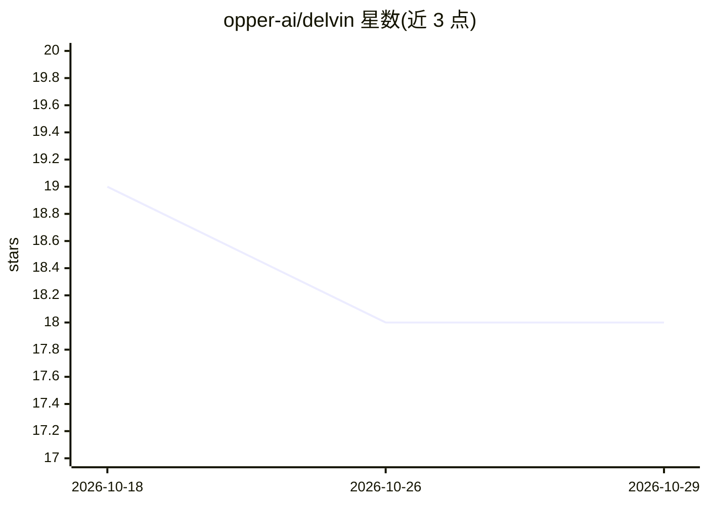

# opper-ai/delvin

⭐ 18 · Python · Apache-2.0 · 推送 2026-08-24 · [GitHub](https://github.com/opper-ai/delvin) · [官网](https://opper.ai) · 组织维护

**尝试解决 SWE-bench Lite 任务的简单文件操作 agent**

Delvin 是一个实验性 agent，通过查看、编辑、搜索文件三种简单动作尝试解决 SWE-bench Lite 数据集中的任务；每个动作经过反思阶段，环境返回的坏 diff、lint 错误会回传给模型。依赖 Python 3.9+、git 与 Opper API key，使用 Opper SDK 构建结构化函数。README 声明达到 23% 通过率但提示结果需谨慎看待；不支持脱离 Opper 后端使用，也不支持直接处理自己的 GitHub issue，需自行修改主文件加载逻辑。

## 筛选速览

| 维度 | 判定 | 备注 |
|---|---|---|
| AI 角色 | `ai-native` | 本体是模型或模型工具 |
| 许可风险 | `permissive` | Apache-2.0 |
| 部署形态 | `None` |  |
| 模型依赖 | — | README 未给出锁定关系 |
| 硬件要求 | — | 无带数字的原话,不猜 |
| 安装摩擦 | `low` | 无编译、无系统依赖或容器化 |
| 成熟度 | `idea` | |

## 能力要点

- agent 可执行查看、编辑、搜索文件三类动作
- 每个动作经过反思阶段，lint 错误与坏 diff 回传模型
- 基于 Opper SDK 构建结构化函数

## 适用场景

- 观察简单动作 agent 在 SWE-bench Lite 上的表现
- 参考 agent 的反思与环境反馈机制实现
- 作为 Opper SDK 的使用示例工程

## 场景标签

`编码 Agent` · 领域:编码与开发

## 证据(README 行号)

> L5: A program _trying_ to solve tasks from the SWE-bench Lite dataset with simple actions
> L27: Delvin is simple agent that can view, edit, and search files. Every action goes through a reflection stage and resu

## 星数曲线

2026-10-18 19 → 2026-10-29 18（-1）

---
*卡片 v1 · prompt 1.4 · 生成 2026-10-29 · 置信度 high · 依据 README sha `e55c1c5fbb4d` · [字段定义](../../DATASET.md)*
