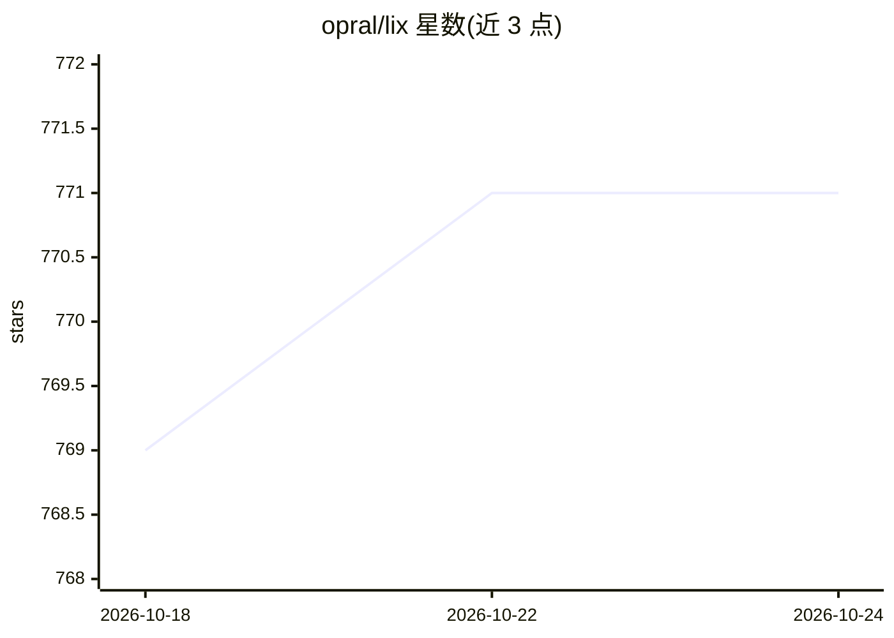

# opral/lix

⭐ 771 · Rust · MIT · 推送 2026-10-14 · [GitHub](https://github.com/opral/lix) · [官网](https://lix.dev) · 组织维护

**可嵌入的文件与 SQL 表版本控制系统，支持人与 agent 协作**

以库形式嵌入产品进程运行的版本控制系统：在单一仓库中同时存储任意格式文件（含二进制、大文件）与应用自定义 SQL 表，对两者提供分支、diff、合并与回滚；文件可通过插件映射为 SQL 行实现结构化 diff。存储可插拔（内存、文件系统、浏览器 OPFS、S3），也可连接服务器。实时协作让人与 agent 共享仓库并即时看到变更；每客户一仓库的托管形态面向带 agent 的 SaaS 产品。README 声明处于 alpha 阶段，权限功能为规划中。

## 筛选速览

| 维度 | 判定 | 备注 |
|---|---|---|
| AI 角色 | `ai-ecosystem` | LLM/agent 周边工具 |
| 许可风险 | `permissive` | MIT |
| 部署形态 | `library` | 以包/库形式分发 |
| 模型依赖 | — | README 未给出锁定关系 |
| 硬件要求 | — | 无带数字的原话,不猜 |
| 安装摩擦 | `low` | 无编译、无系统依赖或容器化 |
| 成熟度 | `idea` | |

## 能力要点

- 文件与 SQL 表在同一仓库中统一版本控制
- 以进程内库形式嵌入，存储可插拔（内存/文件系统/OPFS/S3）
- 插件将文件片段映射为 SQL 行，支持结构化 diff 与合并
- 实时协作让人与 agent 共享仓库并即时同步变更

## 适用场景

- 把代码、文档、设计文件与应用数据库表放进同一个仓库管理
- 为 SaaS 产品给每个客户分配独立版本仓库，支持审查与撤销 agent 的改动
- 在产品中低成本内置历史、blame、分支与回滚等版本化工作流

## 场景标签

 · 领域:开发工具/数据基础设施

## 证据(README 行号)

> L17: - ⚡ **Real-time collaboration.** People and agents share a repository and see changes as they happen.
> L89: Your customers want agents that write automations and edit their documents, with a way to review and undo. Drive's 
> L25: LixRay: a repository for your entire company. Works with Claude, OpenAI, and Gemini.

## 星数曲线

2026-10-18 769 → 2026-10-24 771（+2）

---
*卡片 v1 · prompt 1.4 · 生成 2026-10-21 · 置信度 mid · 依据 README sha `485f14e5d22f` · [字段定义](../../DATASET.md)*
